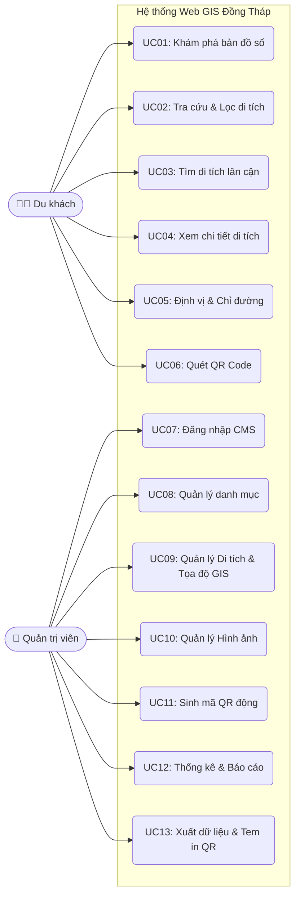

# ĐẶC TẢ USE CASE (CA SỬ DỤNG)
**Dự án:** Xây dựng hệ thống bản đồ số giới thiệu và tra cứu các di tích, địa điểm văn hóa trên địa bàn tỉnh Đồng Tháp.

---

## 1. Sơ đồ Use Case Tổng Quát (UML)

---

## 2. Đặc tả chi tiết Tác nhân (Actors)

*   **Du khách / Người dùng cuối:** Là những người sử dụng hệ thống để tìm kiếm thông tin du lịch, tra cứu di tích trên bản đồ hoặc quét mã QR tại thực địa. Không yêu cầu đăng nhập.
*   **Quản trị viên (Admin):** Cán bộ của Sở VHTTDL hoặc người được giao nhiệm vụ quản trị nội dung. Có tài khoản đăng nhập để vào phân hệ quản trị (CMS).

---

## 3. Danh sách Use Case

### 🧑‍💻 Phân hệ Du khách
*   **UC01 - Khám phá bản đồ số:** Xem bản đồ tương tác, hiển thị các marker di tích. Hệ thống tự động gom cụm (marker cluster) khi thu nhỏ.
*   **UC02 - Tra cứu và Lọc di tích:** Tìm kiếm bằng văn bản (tên di tích). Lọc kết quả theo *Cấp xếp hạng* và *Khu vực hành chính*.
*   **UC03 - Tìm di tích lân cận:** Tính toán khoảng cách và hiển thị các di tích trong bán kính (5km, 10km...) xung quanh tọa độ hiện tại của du khách.
*   **UC04 - Xem chi tiết di tích:** Hiển thị bài viết, thời gian, giá vé, hình ảnh của một di tích cụ thể.
*   **UC05 - Định vị và Chỉ đường:** Lấy tọa độ GPS thiết bị người dùng và vẽ tuyến đường ngắn nhất (Routing) tới di tích trên bản đồ.
*   **UC06 - Truy cập nhanh qua QR Code:** Dùng smartphone quét mã QR tại điểm di tích để vào thẳng trang chi tiết (UC04).

### 👑 Phân hệ Quản trị viên (CMS)
*   **UC07 - Đăng nhập CMS:** Xác thực người dùng bằng Tên đăng nhập và Mật khẩu (dùng JWT Token).
*   **UC08 - Quản lý danh mục hệ thống:** Cấu hình các loại hình di tích, danh sách Huyện/Thành phố thuộc Đồng Tháp.
*   **UC09 - Quản lý Di tích (CRUD):** Thêm mới, cập nhật thông tin bài viết. **Đặc biệt:** Thao tác ghim vị trí trực tiếp trên bản đồ nhỏ trong CMS để lấy tọa độ (Lat, Lng) chính xác.
*   **UC10 - Quản lý Thư viện Hình ảnh:** Upload ảnh, đặt ảnh đại diện (thumbnail) cho các di tích.
*   **UC11 - Quản lý và Sinh mã QR động:** Module tự động tạo QR Code dựa trên ID của di tích, hỗ trợ chèn logo vào giữa mã QR.
*   **UC12 - Theo dõi Thống kê:** Hiển thị Dashboard thống kê số lượt truy cập (View) và số lượt quét mã QR (Scan).
*   **UC13 - Xuất dữ liệu & Biểu mẫu:** Cho phép Admin tải về Tem in QR (PDF/PNG khổ A5), Báo cáo dữ liệu (Excel) và dữ liệu không gian (GeoJSON).
