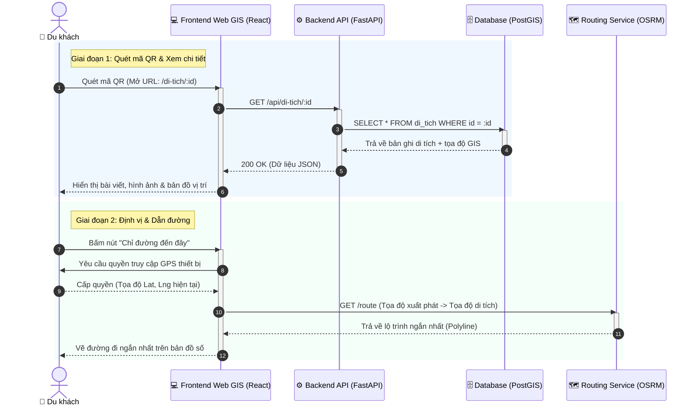

# SƠ ĐỒ TUẦN TỰ (SEQUENCE DIAGRAM)
**Tiến trình:** Quét mã QR tại thực địa để tra cứu chi tiết và xin chỉ đường
**Actor:** Du khách (Mobile Browser), Frontend (React), Backend API (FastAPI), CSDL (PostGIS), Routing Service (OSRM/Mapbox)

## Diễn giải sơ đồ tuần tự:
1. **Quét mã QR tại thực địa:** Du khách quét mã QR bằng camera điện thoại, hệ thống điều hướng trực tiếp đến route chi tiết di tích trên Frontend mà không cần tìm kiếm thủ công.
2. **Truy vấn CSDL Không gian:** FastAPI nhận ID từ Frontend, truy xuất bản ghi trong PostgreSQL/PostGIS và trả về thông tin chi tiết kèm tọa độ chuẩn WGS84.
3. **Định vị & Chỉ đường tự động:** Khi người dùng yêu cầu chỉ đường, ứng dụng lấy tọa độ GPS thời gian thực từ trình duyệt và gọi API dịch vụ định tuyến (OSRM/Mapbox) để vẽ lộ trình ngắn nhất trên nền bản đồ Leaflet.
