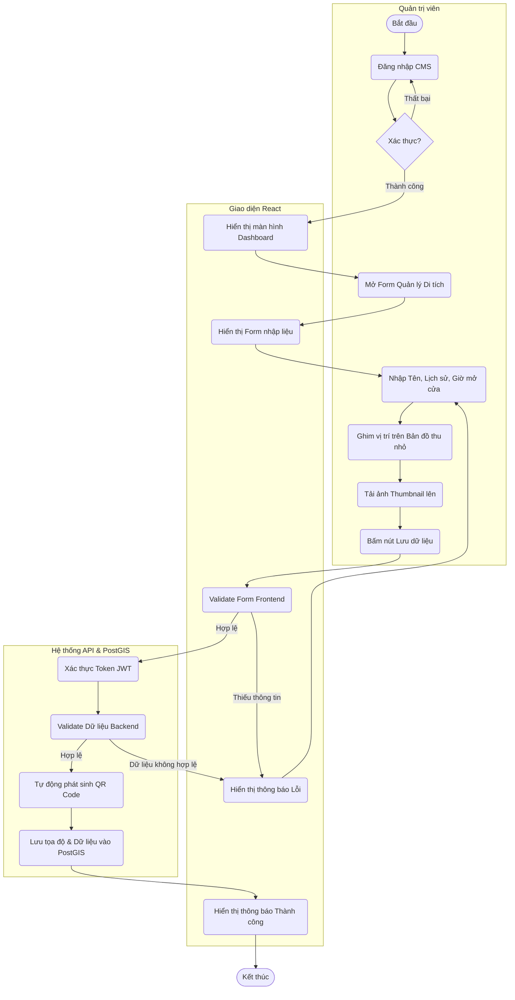

# SƠ ĐỒ HOẠT ĐỘNG (ACTIVITY DIAGRAM)
**Tiến trình:** Thêm mới hoặc Cập nhật thông tin Di tích
**Actor:** Quản trị viên (Admin), Hệ thống (Frontend & Backend)

## Diễn giải quy trình:
1. **Khởi tạo:** Admin đăng nhập vào hệ thống CMS. Sau khi xác thực thành công, hệ thống hiển thị Dashboard.
2. **Nhập liệu:** Admin mở form Thêm mới/Cập nhật di tích.
3. **Thao tác bản đồ (Quan trọng):** Thay vì nhập thủ công Vĩ độ / Kinh độ, Admin ghim (click) trực tiếp vào vị trí di tích trên bản đồ thu nhỏ. Frontend tự động lấy tọa độ (Lat, Lng) điền vào form.
4. **Xử lý:** Sau khi gửi dữ liệu, Backend kiểm tra tính hợp lệ. Nếu hợp lệ, một mã QR động (chứa URL trỏ về trang di tích) sẽ được tự động tạo ra.
5. **Lưu trữ:** Toàn bộ thông tin, tọa độ không gian và file QR được lưu vào cơ sở dữ liệu PostGIS. Giao diện báo thành công.