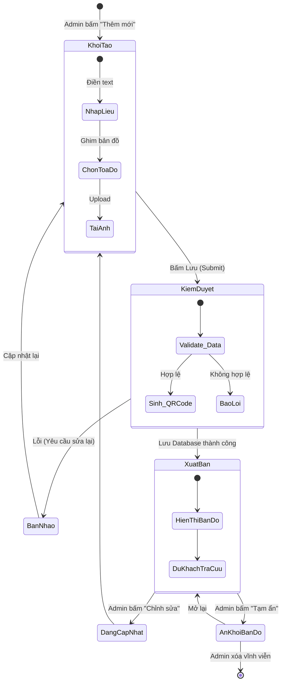

# SƠ ĐỒ TRẠNG THÁI (STATE MACHINE DIAGRAM)
**Tiến trình:** Vòng đời của một bài viết / thông tin Di tích trên hệ thống
**Đối tượng:** Thực thể `Di_Tich`

## Diễn giải các trạng thái:
1. **Khởi tạo (Bản nháp):** Trạng thái khi Admin đang nhập liệu trên form, chưa lưu vào CSDL.
2. **Kiểm duyệt (Processing):** Trạng thái hệ thống đang chạy ngầm (validate, sinh mã QR). Diễn ra rất nhanh chóng.
3. **Bản nháp (Draft / Lỗi):** Nếu thông tin không hợp lệ, dữ liệu quay về trạng thái chờ chỉnh sửa.
4. **Xuất bản (Published):** Trạng thái chuẩn của một di tích. Lúc này di tích đã có mặt trên bản đồ số, Du khách có thể tìm kiếm, quét QR hoặc xin chỉ đường tới đây.
5. **Đang cập nhật (Editing):** Chuyển về khi Admin cần bổ sung lịch sử hoặc sửa tọa độ.
6. **Ẩn khỏi bản đồ (Archived):** Di tích tạm thời đóng cửa hoặc đang trùng tu, Admin chuyển sang trạng thái "Ẩn" để du khách không tìm thấy trên bản đồ public, nhưng dữ liệu vẫn còn trong CMS. Có thể xóa vĩnh viễn để kết thúc vòng đời.