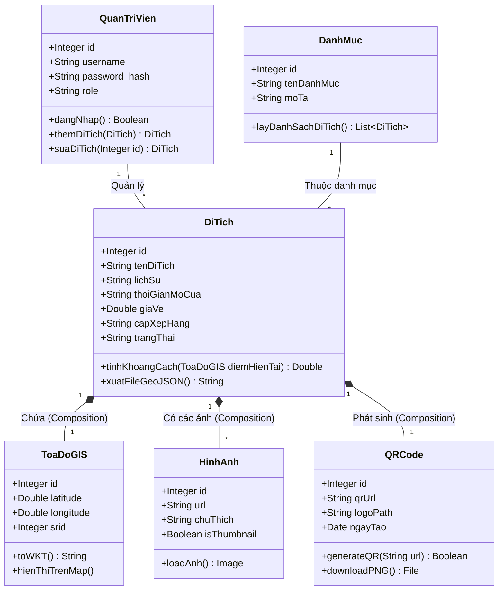

# SƠ ĐỒ LỚP (CLASS DIAGRAM)
**Nhóm sơ đồ:** Cấu trúc Hệ thống
**Mục tiêu:** Mô tả cấu trúc các đối tượng lập trình (Entities/Classes) và mối quan hệ giữa chúng trong Backend (FastAPI) và CSDL (PostGIS).

## Diễn giải cấu trúc Lớp:
1. **Lớp Trung tâm (`DiTich`):** Là lõi của toàn bộ phần mềm. Chứa các thuộc tính văn bản (tên, lịch sử, giờ mở cửa) và có các hàm xử lý chuyên biệt cho hệ thống GIS như `tinhKhoangCach()` (để quét bán kính 5km, 10km) hoặc xuất ra định dạng bản đồ `GeoJSON`.
2. **Quan hệ Composition (*--):** 
   - Lớp `ToaDoGIS`, `HinhAnh` và `QRCode` gắn liền vòng đời với `DiTich`. Nếu một Di tích bị Admin xóa khỏi hệ thống, tọa độ không gian, hình ảnh và mã QR của nó cũng sẽ tự động bị xóa theo (Cascade Delete).
   - Lớp `ToaDoGIS` tách riêng các thuộc tính Vĩ độ (`latitude`) và Kinh độ (`longitude`) để xử lý bằng thư viện GeoAlchemy2 trong Backend.
3. **Quan hệ Association (--):** Lớp `QuanTriVien` và `DanhMuc` có mối liên kết với `DiTich`. Một Admin có thể nhập liệu hàng chục Di tích, và một Danh mục (VD: Di tích khảo cổ) sẽ gom nhóm nhiều Di tích lại với nhau.