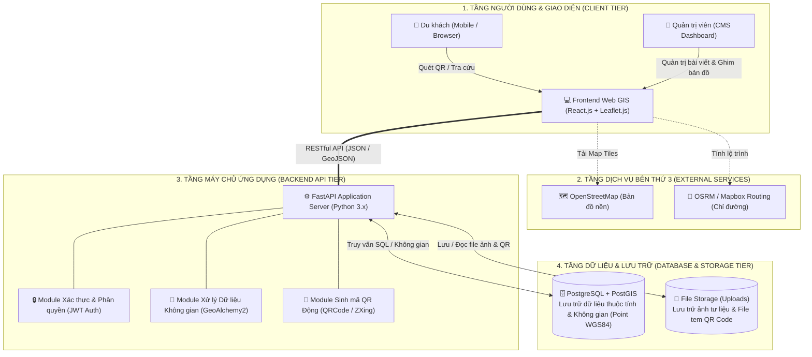

# SƠ ĐỒ KIẾN TRÚC HỆ THỐNG (ARCHITECTURE DIAGRAM)
**Nhóm sơ đồ:** Cấu trúc Hệ thống
**Mục tiêu:** Mô tả kiến trúc tổng thể các phân tầng (Client - API Server - GIS Service - Database) của hệ thống Web GIS Đồng Tháp.

## Diễn giải kiến trúc phân tầng:
1. **Tầng Giao diện (Client Tier):** Ứng dụng Single Page Application (SPA) viết bằng React.js + Tailwind CSS, tích hợp thư viện bản đồ Leaflet.js. Tối ưu hóa giao diện Mobile-First phục vụ du khách quét mã QR tại thực địa.
2. **Tầng Dịch vụ bên thứ ba (External Services):** Bản đồ nền được tải trực tiếp từ OpenStreetMap (OSM) về trình duyệt du khách, giúp giảm tải băng thông cho máy chủ chính. Dịch vụ chỉ đường OSRM/Mapbox cung cấp thuật toán tìm đường ngắn nhất.
3. **Tầng Máy chủ (Backend Tier):** Xây dựng bằng Python FastAPI hiệu năng cao, phân tách các module nghiệp vụ rõ ràng: xác thực JWT, xử lý tọa độ không gian và module sinh mã QR động chèn logo nhận diện.
4. **Tầng Dữ liệu (Database Tier):** PostgreSQL kết hợp phần mở rộng PostGIS lưu trữ dữ liệu không gian chuẩn quốc tế (WGS 84 / SRID 4326), đánh chỉ mục không gian R-Tree/GiST đảm bảo thời gian phản hồi truy vấn dưới 1 giây.
