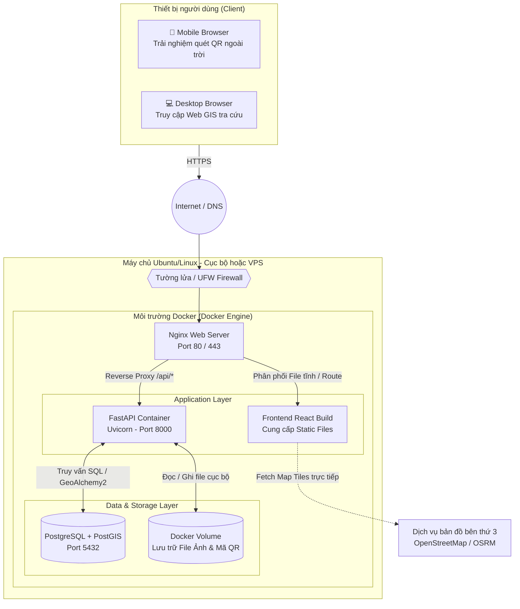

# SƠ ĐỒ TRIỂN KHAI (DEPLOYMENT DIAGRAM)
**Nhóm sơ đồ:** Cấu trúc Hệ thống
**Mục tiêu:** Trình bày mô hình vật lý/logic khi đưa hệ thống Web GIS vào hoạt động thực tế (Production) trên máy chủ.

## Diễn giải kiến trúc triển khai:
1. **Kiến trúc Container hóa (Docker):** Để đảm bảo tính ổn định và dễ dàng cài đặt lại, hệ thống Backend (FastAPI) và CSDL Không gian (PostGIS) sẽ được đóng gói thành các Docker Container.
2. **Web Server Nginx (Reverse Proxy):** Nginx đóng vai trò là "người gác cổng" duy nhất. 
   - Nếu người dùng truy cập trang chủ (VD: `dongthapgis.vn`), Nginx sẽ trả về file tĩnh của ReactJS. 
   - Nếu có các yêu cầu gọi dữ liệu từ React gửi tới đường dẫn `/api/*`, Nginx sẽ đóng vai trò Reverse Proxy, chuyển tiếp (forward) luồng dữ liệu đó vào trong FastAPI Container (Port 8000).
3. **Lưu trữ dữ liệu (Volume):** Ảnh do Admin tải lên và Mã QR do hệ thống tự sinh sẽ không nằm trong container (tránh mất dữ liệu khi restart máy chủ), mà được mapping ra một phân vùng ổ cứng thật của Server thông qua Docker Volume.
4. **Tối ưu băng thông:** Các dữ liệu bản đồ nặng (Map Tiles) được trình duyệt của du khách tải trực tiếp từ máy chủ OpenStreetMap (OSM) thông qua Internet, giúp máy chủ hệ thống không bị quá tải băng thông.
