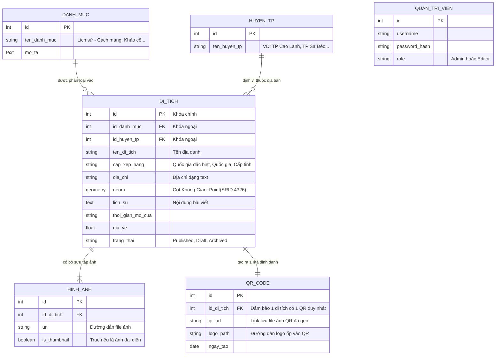

# SƠ ĐỒ THỰC THỂ MỐI QUAN HỆ (ERD - LOGICAL DATABASE)
**Nhóm sơ đồ:** Dữ liệu & Quy trình
**Hệ quản trị CSDL:** PostgreSQL + PostGIS Extension

## Diễn giải mô hình CSDL:
1. **Thiết kế Chuẩn hóa (Normalization):** Các thông tin lặp lại như Tên huyện, Tên loại hình di tích được tách ra thành các bảng `HUYEN_TP` và `DANH_MUC` riêng biệt để dễ dàng lọc (Filter) và tìm kiếm trên giao diện Web GIS.
2. **Cột Dữ liệu Không gian (Spatial Column):** Điểm nhấn của DB này là cột `geom` trong bảng `DI_TICH`. Nó sử dụng kiểu dữ liệu `geometry` của extension **PostGIS** thay vì lưu `lat` và `lng` bằng 2 cột float riêng biệt. Thiết kế này giúp Database có thể chạy các hàm nội tại như `ST_Distance()` để quét bán kính 5km lân cận cực kỳ nhanh.
3. **Mối quan hệ 1-1 (One-to-One):** `DI_TICH` và `QR_CODE` có quan hệ 1-1 chặt chẽ. ID của di tích chính là hạt giống (seed) để thuật toán sinh ra URL và tạo ảnh mã QR.