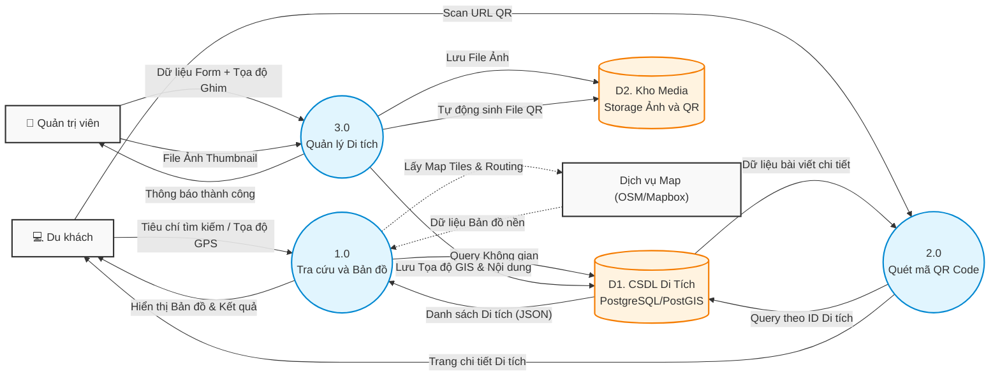

# SƠ ĐỒ LUỒNG DỮ LIỆU (DATA FLOW DIAGRAM - DFD MỨC 1)
**Nhóm sơ đồ:** Dữ liệu & Quy trình
**Mục tiêu:** Trình bày luồng di chuyển của dữ liệu giữa các Thực thể (Người dùng), Tiến trình xử lý (Hệ thống) và Kho lưu trữ (Database).

## Diễn giải Sơ đồ Luồng dữ liệu (DFD):
- **Thực thể ngoài (Hình chữ nhật):** `Du khách`, `Quản trị viên`, và dịch vụ bên thứ 3 `OSM`. Đây là nơi bắt nguồn và kết thúc của dữ liệu.
- **Tiến trình (Hình tròn/Elip):** Hệ thống được chia làm 3 cụm tiến trình chính: Tra cứu, Quét QR (dành cho người dùng public) và Quản lý Di tích (dành cho Admin).
- **Kho dữ liệu (Hình trụ hở):** Hệ thống có 2 kho dữ liệu tách biệt. `D1` lưu trữ các dữ liệu có cấu trúc (văn bản, tọa độ GIS). `D2` là kho lưu trữ file tĩnh (File ảnh upload và File ảnh QR sinh tự động).
- **Luồng dữ liệu (Mũi tên):** Mô tả chính xác *dữ liệu gì* đang được truyền đi. Ví dụ: Tiến trình `1.0` truyền `Query Không gian` tới `D1`, và nhận lại `Danh sách Di tích (JSON)`.
