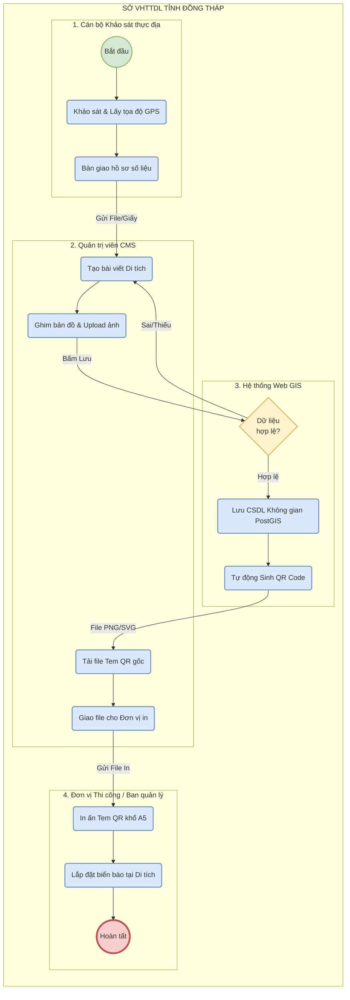

# SƠ ĐỒ QUY TRÌNH NGHIỆP VỤ (BPMN 2.0)
**Nhóm sơ đồ:** Dữ liệu & Quy trình
**Quy trình:** Nghiệp vụ Khảo sát, Số hóa và Phát hành Tem mã QR tại Di tích.
**Đơn vị chủ quản (Pool):** Sở Văn hóa, Thể thao và Du lịch tỉnh Đồng Tháp.

## Diễn giải Quy trình nghiệp vụ:
Sơ đồ BPMN chia quy trình thành 4 luồng bơi (Swimlanes) tương ứng với 4 đối tượng tham gia vào quy trình số hóa:
1. **Cán bộ Khảo sát:** Là người đi thực địa (Fieldwork), tới tận các di tích (VD: Gò Tháp, Xẻo Quýt) để ghi nhận hiện trạng, lấy tọa độ Vĩ độ/Kinh độ chính xác và chụp ảnh tư liệu.
2. **Quản trị viên:** Chịu trách nhiệm vận hành hệ thống phần mềm CMS. Họ tiếp nhận hồ sơ từ cán bộ khảo sát, nhập liệu vào hệ thống và duyệt bài.
3. **Hệ thống Web GIS:** Đóng vai trò tự động hóa nghiệp vụ (Automated Task). Khi Admin bấm lưu, hệ thống có rẽ nhánh (Gateway) để Validate dữ liệu. Nếu thành công, hệ thống tự động làm 2 việc: Lưu CSDL không gian và Sinh mã QR động.
4. **Đơn vị Thi công:** Nhận file thiết kế Tem QR từ Admin để mang đi in ấn gia công (mica/nhựa/kim loại) và đóng biển báo tại thực địa, giúp du khách quét mã.
