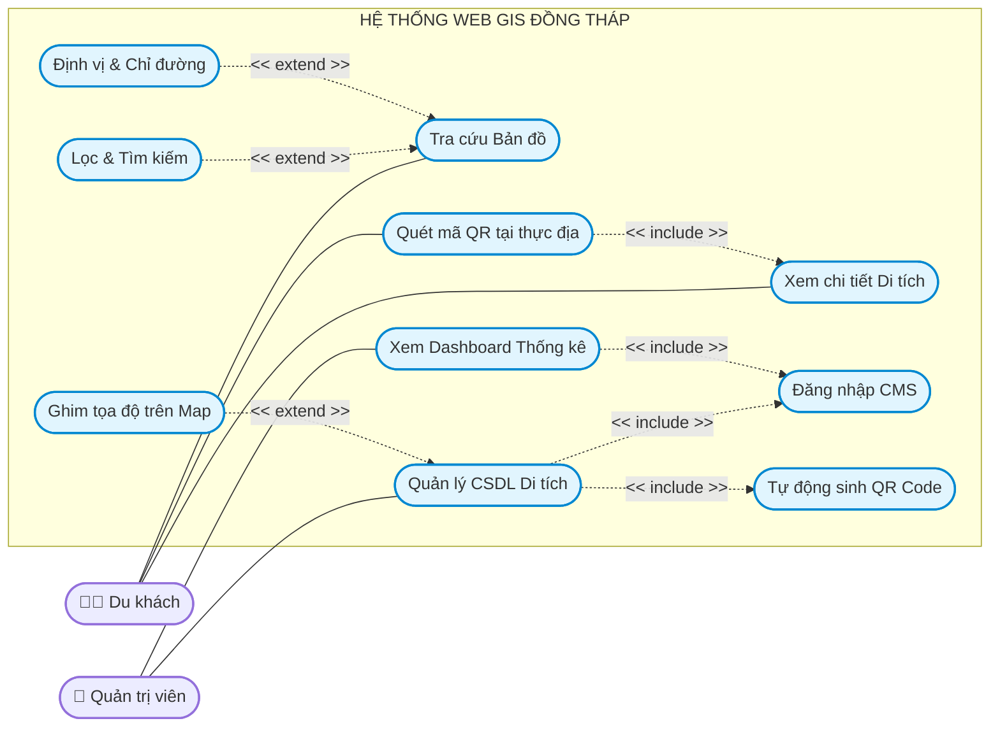

# SƠ ĐỒ USE CASE CHI TIẾT (UML)
**Nhóm sơ đồ:** Dữ liệu & Quy trình
**Mục tiêu:** Đặc tả tương tác chi tiết giữa Người dùng và Hệ thống, có sử dụng các liên kết chuẩn UML `<<include>>` (Bắt buộc) và `<<extend>>` (Mở rộng).

## Giải thích các liên kết UML (Dùng cho Báo cáo):
1. **Liên kết `<<include>>` (Bao hàm - Bắt buộc xảy ra):**
   - Mũi tên trỏ từ `Quản lý CSDL Di tích` đến `Đăng nhập CMS`: Có nghĩa là để quản lý được di tích, hệ thống *bắt buộc* phải bắt Admin đi qua bước đăng nhập.
   - Mũi tên từ `Quản lý CSDL Di tích` đến `Tự động sinh QR Code`: Khi Admin bấm lưu thông tin thành công, nghiệp vụ sinh QR sẽ tự động bị gọi (bắt buộc chạy ngầm).
   - Mũi tên từ `Quét mã QR` đến `Xem chi tiết`: Khi quét QR thành công, hành động bắt buộc tiếp theo là chuyển hướng tải trang chi tiết.

2. **Liên kết `<<extend>>` (Mở rộng - Không bắt buộc):**
   - Mũi tên trỏ từ `Lọc & Tìm kiếm` về `Tra cứu Bản đồ`: Du khách có thể chỉ kéo xem bản đồ đơn thuần. Việc dùng thanh tìm kiếm hoặc bộ lọc là một chức năng dùng thêm (mở rộng).
   - Tương tự với `Định vị & Chỉ đường`, đây là công cụ tùy chọn khi du khách muốn bật GPS tìm đường.
   - Mũi tên trỏ từ `Ghim tọa độ trên Map` về `Quản lý CSDL Di tích`: Khi nhập liệu, Admin có thể nhập tay số Vĩ độ/Kinh độ, HOẶC dùng tính năng mở rộng là Click ghim thẳng lên bản đồ thu nhỏ.
