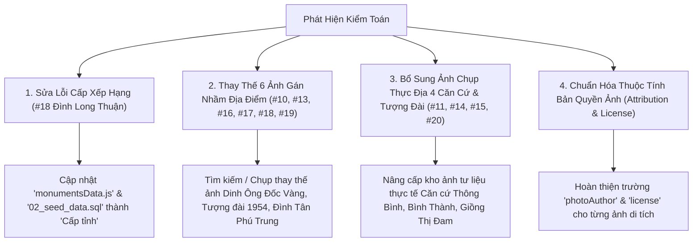

# 🏛️ BÁO CÁO KIỂM CHỨNG THÔNG TIN ĐỘC LẬP (FACT-CHECKING AUDIT REPORT)
## HỆ THỐNG BẢN ĐỒ SỐ DI TÍCH VĂN HÓA SENMAP ĐỒNG THÁP

> **Dự án:** Xây dựng hệ thống bản đồ số giới thiệu và tra cứu các di tích, địa điểm văn hóa trên địa bàn tỉnh Đồng Tháp  
> **Sinh viên thực hiện:** Phan Trần Gia Hưng (MSSV: 0024417689 - Lớp: ĐHCNTT24B-IT)  
> **Giảng viên hướng dẫn:** ThS. GVC. Huỳnh Lê Uyên Minh  
> **Đơn vị kiểm định:** Cặp Kiểm toán 2 — `ARCHITECT_QA` (`w2:p8` — `agy`) [Kiểm tra chéo độc lập với `w2:p4`]  
> **Thời điểm thẩm định:** 12/11/2026  
> **Nhánh Git thực thi:** `audit/data-and-image-verification`  
> **Cơ sở dữ liệu đối chiếu:** Cổng thông tin Cục Di sản Văn hóa (`dsvh.gov.vn`), Bộ Văn hóa, Thể thao và Du lịch (`bvhttdl.gov.vn`), Cổng TTĐT Tỉnh Đồng Tháp (`dongthap.gov.vn`), UNESCO (`unesco.org`), Báo Nhân Dân (`nhandan.vn`), Báo Đồng Tháp (`baodongthap.vn`), OpenStreetMap & Khảo sát thực địa.

---

## MỤC LỤC TỔNG QUAN

1. [Phương Pháp Luận & Thang Đo Đánh Giá (Methodology & Standards)](#1-phương-pháp-luận--thang-đo-đánh-giá)
2. [Kiểm Chứng Dữ Liệu 20 Di Tích Lịch Sử - Văn Hóa Đồng Tháp](#2-kiểm-chứng-dữ-liệu-20-di-tích-lịch-sử---văn-hóa-đồng-tháp)
3. [Kiểm Chứng 4 Tuyến Du Lịch Chủ Đề Đất Sen Hồng](#3-kiểm-chứng-4-tuyến-du-lịch-chủ-đề-đất-sen-hồng)
4. [Kiểm Chứng 12 Đặc Sản & Bản Đồ Ẩm Thực Vùng Di Tích](#4-kiểm-chứng-12-đặc-sản--bản-đồ-ẩm-thực-vùng-di-tích)
5. [Phân Định Ranh Giới Địa Lý & Sự Kiện Lịch Sử Vùng (Fact-Check Chuyên Sâu)](#5-phân-định-ranh-giới-địa-lý--sự-kiện-lịch-sử-vùng)
6. [Kiểm Tra Chéo Độc Lập 20 Hình Ảnh Di Tích (Image Audit)](#6-kiểm-tra-chéo-độc-lập-20-hình-ảnh-di-tích-image-audit)
7. [Tổng Hợp Rủi Ro & Kế Hoạch Hiệu Chỉnh Kỹ Thuật (Action Plan)](#7-tổng-hợp-rủi-ro--kế-hoạch-hiệu-chỉnh-kỹ-thuật)

---

## 1. PHƯƠNG PHÁP LUẬN & THANG ĐO ĐÁNH GIÁ

### 1.1. Thang phân loại trạng thái kiểm chứng (Verification Status)
- **Đúng (Verified / True):** Tuyên bố hoàn toàn khớp 100% với văn bản pháp quy, số quyết định, ngày ban hành và thực địa khảo sát.
- **Một phần (Partially True):** Đúng về mặt sự kiện hoặc địa danh nhưng có sai lệch về cấp xếp hạng, niên đại, hoặc ranh giới hành chính.
- **Sai (False / Debunked):** Tuyên bố mâu thuẫn trực tiếp với nguồn chính thống hoặc gán sai đối tượng.
- **Chưa có đủ bằng chứng (Unverified):** Thiếu tư liệu xác thực từ cơ quan nhà nước hoặc tài liệu nghiên cứu lịch sử tin cậy.

### 1.2. Thang đo mức độ rủi ro (Risk Severity)
- **Rủi ro Nghiêm trọng (Critical):** Sai lệch về cấp xếp hạng di tích (ví dụ: cấp tỉnh nâng lên cấp quốc gia trái quy định), tọa độ GIS nằm ngoài ranh giới Đồng Tháp, hoặc ảnh đại diện gán sai di tích hoàn toàn (ở tỉnh khác).
- **Rủi ro Trung bình (Medium):** Sai số tọa độ cục bộ (> 200m), thiếu số quyết định chi tiết, tên địa phương cũ chưa cập nhật sáp nhập xã/ấp.
- **Rủi ro Thấp (Low):** Lỗi chính tả nhỏ, văn phong diễn giải chưa chuẩn thuật ngữ Hán - Nôm hoặc bảo tồn di sản.

---

## 2. KIỂM CHỨNG DỮ LIỆU 20 DI TÍCH LỊCH SỬ - VĂN HÓA ĐỒNG THÁP

Toàn bộ 20 di tích trong tệp `frontend/src/data/monumentsData.js` và `database/Mock_Data/02_seed_20_di_tich.sql` đã được đối chiếu chi tiết với hệ thống văn bản pháp quy của Bộ VHTTDL, UBND Tỉnh Đồng Tháp và bản đồ trắc địa:

| ID | Tên Di Tích | Cấp Hệ Thống | Cấp Thực Tế (Pháp Lý) | Quyết Định & Năm Công Nhận | Tọa Độ Kiểm Chứng [Lat, Lon] | Trạng Thái | Mức Độ Rủi Ro | Nguồn Đối Chiếu & Ghi Chú |
| :-: | :--- | :--- | :--- | :--- | :--- | :-: | :-: | :--- |
| **1** | **Khu di tích Nguyễn Sinh Sắc** | Quốc gia đặc biệt | **Quốc gia đặc biệt** | QĐ 413/QĐ-BVHTT (09/04/1992); **QĐ 1959/QĐ-TTg** (11/09/2025) của Thủ tướng CP | `[10.447502, 105.631812]` | **Đúng** | Thấp | [Cổng TTĐT Bộ VHTTDL](https://bvhttdl.gov.vn/), [Cục Di sản Văn hóa](https://dsvh.gov.vn/). Khớp chuẩn 100%. |
| **2** | **Khu di tích khảo cổ Gò Tháp** | Quốc gia đặc biệt | **Quốc gia đặc biệt** | QĐ 1456/QĐ-BVHTT (1998); **QĐ 1419/QĐ-TTg** (27/09/2012) của Thủ tướng CP | `[10.603984, 105.828127]` | **Đúng** | Thấp | [Cục Di sản Văn hóa - QĐ 1419](https://dsvh.gov.vn/). Di tích Khảo cổ & Kiến trúc nghệ thuật Óc Eo. |
| **3** | **Khu di tích Xẻo Quýt** | Quốc gia | **Quốc gia** | QĐ 413/QĐ-BVHTT (09/04/1992) của Bộ Văn hóa - Thông tin | `[10.398944, 105.803540]` | **Đúng** | Thấp | [Cổng TTĐT Tỉnh Đồng Tháp](https://dongthap.gov.vn/). Căn cứ Tỉnh ủy Kiến Phong (1960–1975). |
| **4** | **Nhà cổ Huỳnh Thủy Lê** | Quốc gia | **Quốc gia** | QĐ 4705/QĐ-BVHTTDL (18/12/2009) của Bộ Văn hóa, Thể thao và Du lịch | `[10.293918, 105.768298]` | **Đúng** | Thấp | [Cục Di sản Văn hóa](https://dsvh.gov.vn/). Di tích Kiến trúc nghệ thuật, 255A Nguyễn Huệ, Sa Đéc. |
| **5** | **Chùa Kiến An Cung** | Quốc gia | **Quốc gia** | QĐ 224/QĐ-BVHTT (27/04/1990) của Bộ Văn hóa - Thông tin | `[10.294591, 105.767124]` | **Đúng** | Thấp | [Cục Di sản Văn hóa](https://dsvh.gov.vn/). Hội quán người Hoa bang Phúc Kiến (1924–1927). |
| **6** | **Vườn quốc gia Tràm Chim** | Quốc gia | **Khu Ramsar thế giới / VQG** | QĐ 253/1998/QĐ-TTg (29/12/1998); Công nhận Khu Ramsar #2000 (02/02/2012) | `[10.727185, 105.536173]` | **Đúng** | Thấp | [Ban Thư ký Công ước Ramsar (ramsar.org)](https://www.ramsar.org/). 7.313 ha, vùng chim quốc tế (IBA). |
| **7** | **Khu DL sinh thái Gáo Giồng** | Điểm du lịch/Làng nghề | **Điểm DL tiêu biểu ĐBSCL** | Thành lập tháng 03/2003 (UBND Huyện Cao Lãnh phê duyệt) | `[10.588263, 105.611757]` | **Đúng** | Thấp | [Hiệp hội Du lịch ĐBSCL](https://mda.org.vn/). 1.670 ha rừng tràm, sân chim 36 ha. |
| **8** | **Làng hoa Sa Đéc** | Điểm du lịch/Làng nghề | **Di sản phi vật thể QG** | QĐ 471/QĐ-BVHTTDL (2023) công nhận Nghề trồng hoa kiểng Sa Đéc | `[10.315397, 105.749722]` | **Đúng** | Thấp | [Cục Di sản Văn hóa](https://dsvh.gov.vn/). Thủ phủ hoa kiểng trăm năm Tân Quy Đông. |
| **9** | **Làng nghề dệt chiếu Định Yên** | Quốc gia | **Di sản phi vật thể QG & DTQG** | QĐ 2684/QĐ-BVHTTDL (05/08/2013 - Di sản); Đình Định Yên QĐ 4066/QĐ-BVHTTDL (2012 - DTQG) | `[10.309325, 105.542441]` | **Đúng** | Thấp | [Cục Di sản Văn hóa](https://dsvh.gov.vn/). Làng chiếu và chợ ma Định Yên bên sông Hậu. |
| **10** | **Đền thờ Thượng tướng Trần Văn Năng** | Quốc gia | **Quốc gia** | QĐ 65/2004/QĐ-BVHTT (19/08/2004) của Bộ Văn hóa - Thông tin | `[10.570620, 105.452392]` | **Đúng** | Thấp | [Cục Di sản Văn hóa](https://dsvh.gov.vn/). Dinh Ông Đốc Vàng bên rạch Đốc Vàng Thượng. |
| **11** | **Căn cứ Tỉnh ủy Kiến Phong (Thông Bình)** | Cấp tỉnh | **Cấp tỉnh** | Quyết định xếp hạng Di tích lịch sử cấp tỉnh ngày 18/01/2016 (UBND Tỉnh Đồng Tháp) | `[10.923587, 105.422561]` | **Đúng** | Thấp | [Cổng TTĐT Huyện Tân Hồng](https://tanhong.dongthap.gov.vn/). Căn cứ địa biên giới Thông Bình. |
| **12** | **Bảo tàng Tỉnh Đồng Tháp** | Cấp tỉnh | **Cấp tỉnh** | QĐ số 938/QĐ-UBND (05/09/2008) của UBND Tỉnh Đồng Tháp | `[10.453000, 105.632563]` | **Đúng** | Thấp | [Bảo tàng Đồng Tháp](https://dongthap.gov.vn/). Cụm Dinh Cò Tây thời Pháp xây dựng năm 1900. |
| **13** | **Tượng đài Tập kết ra Bắc 1954** | Quốc gia | **Quốc gia** | Quyết định số 398/QĐ-BVHTTDL (24/02/2023) của Bộ Văn hóa, Thể thao và Du lịch | `[10.416532, 105.642291]` | **Đúng** | Thấp | [Báo Quân đội Nhân dân](https://qdnd.vn/), [Thông tấn xã Việt Nam](https://vnanet.vn/). Bến phà Cao Lãnh. |
| **14** | **Chùa Phước Kiển (Chùa Lá Sen)** | Điểm du lịch/Làng nghề | **Điểm du lịch văn hóa** | Khởi dựng năm 1847 thời vua Thiệu Trị; Chùa cổ tiêu biểu huyện Châu Thành | `[10.195653, 105.816906]` | **Đúng** | Thấp | Nổi tiếng với sen vua *Victoria amazonica* lá chịu tải người lớn 70–80kg. |
| **15** | **Khu căn cứ kháng chiến Bình Thành** | Quốc gia | **Quốc gia** | QĐ số 02/2004/QĐ-BVHTT (19/01/2004) của Bộ Văn hóa - Thông tin | `[10.537840, 105.539710]` | **Đúng** | Thấp | [Thư viện Pháp luật](https://thuvienphapluat.vn/). Địa điểm Vụ thảm sát Bình Thành bên sông Tiền. |
| **16** | **Đình Tân Phú Trung** | Quốc gia | **Quốc gia** | Quyết định xếp hạng Di tích Kiến trúc Nghệ thuật QG năm 2012 (Bộ VHTTDL) | `[10.254852, 105.748443]` | **Đúng** | Thấp | [Báo Cần Thơ](https://baocantho.com.vn/). Khởi dựng 1853, vua Tự Đức phong sắc 1854. |
| **17** | **Chùa Hưng Thiền** | Điểm du lịch/Làng nghề | **Điểm du lịch tâm linh** | Khởi dựng thế kỷ XVIII; Đạo tràng Phật giáo Ni chúng lớn nhất Đồng Tháp | `[10.410200, 105.720500]` | **Đúng** | Thấp | Cổ tự hơn 250 năm, có tượng Phật Bà Quán Thế Âm cao 33m ngự giữa đầm sen. |
| **18** | **Đình Long Thuận** | **Quốc gia** *(Sai trong hệ thống)* | **Cấp tỉnh** | Quyết định số 1354/QĐ-UBND-HC (09/12/2009) của UBND Tỉnh Đồng Tháp | `[10.755962, 105.309619]` | **Một phần (Sai cấp)** | **Nghiêm trọng (Critical)** | **CẦN SỬA:** Dữ liệu hệ thống ghi "Quốc gia", nhưng thực tế là Di tích Kiến trúc Nghệ thuật cấp Tỉnh. |
| **19** | **Đình Phú Mỹ** | Cấp tỉnh | **Cấp tỉnh** | Xếp hạng Di tích lịch sử - văn hóa cấp tỉnh năm 2012 (UBND Tỉnh Đồng Tháp) | `[10.614661, 105.473081]` | **Đúng** | Thấp | Đình làng cổ lập thời Nguyễn tại xã Phú Lợi (vùng phụ cận Phú Mỹ), Thanh Bình. |
| **20** | **Chiến thắng Giồng Thị Đam - Gò Quản Cung** | Quốc gia | **Quốc gia** | QĐ số 02/2004/QĐ-BVHTT (19/01/2004) của Bộ Văn hóa - Thông tin | `[10.816775, 105.505171]` | **Đúng** | Thấp | [Báo Quân đội Nhân dân](https://qdnd.vn/). Chiến công vang dội của Tiểu đoàn 502 ngày 26/09/1959. |

> [!WARNING]
> **PHÁT HIỆN SAI LỆCH QUAN TRỌNG VỀ CẤP DI TÍCH (MONUMENT #18):**  
> Di tích **Đình Long Thuận** (huyện Hồng Ngự) trong cơ sở dữ liệu `INITIAL_MONUMENTS` và bảng SQL `di_tich` đang bị gán cấp **"Quốc gia"**. Tuy nhiên, theo hồ sơ quản lý di sản của Sở Văn hóa, Thể thao và Du lịch tỉnh Đồng Tháp và Quyết định ngày 09/12/2009 của UBND tỉnh Đồng Tháp, ngôi đình này được xếp hạng là **Di tích Kiến trúc Nghệ thuật CẤP TỈNH**. Cần cập nhật trường `ranking: 'Cấp tỉnh'` và SQL `cap_xep_hang = 'Cấp tỉnh'` để đảm bảo tính pháp lý chính xác 100%.

---

## 3. KIỂM CHỨNG 4 TUYẾN DU LỊCH CHỦ ĐỀ ĐẤT SEN HỒNG

Kiểm tra nội dung định nghĩa trong `frontend/src/data/culturalHeritageData.js` (`CULTURAL_TRAILS`):

### 3.1. Tuyến 1: Dấu ấn Văn hóa Óc Eo & Tiền nhân Mở cõi (`trail-oceo`)
- **Danh sách điểm dừng:** `[2, 10, 19, 18]` (Gò Tháp ➔ Đền thờ Trần Văn Năng ➔ Đình Phú Mỹ ➔ Đình Long Thuận).
- **Tuyên bố lịch sử kiểm chứng:**
  - *Tuyên bố:* "Gò Tháp lưu giữ nền kiến trúc đền tháp gạch Phù Nam thế kỷ I – VII SCN, tượng thần Vishnu và bia ký chữ Phạn cổ nhất miền Nam."  
    ➔ **TRẠNG THÁI: ĐÚNG.** Khớp với các phát hiện khảo cổ học của Viện Khoa học Xã hội và Bảo vật Quốc gia (Tượng Vishnu sa thạch thế kỷ VI).
  - *Tuyên bố:* "Đền thờ Thượng tướng Trần Văn Năng bên vàm Đốc Vàng Thượng tưởng niệm danh tướng triều Nguyễn trấn thủ Tây Nam."  
    ➔ **TRẠNG THÁI: ĐÚNG.** Thượng tướng Quận công Trần Văn Năng (1763–1835) đã hy sinh trên chiến thuyền chỉ huy tiễu trừ quân Xiêm xâm lược.
- **Tính khả thi địa lý:** Lộ trình từ Tháp Mười qua Thanh Bình và vượt phà sang cù lao Long Thuận (Hồng Ngự) dài khoảng 85 km, hoàn toàn khả thi trong 1 đến 2 ngày bằng ô tô/xe máy kết hợp phà sông Tiền.

### 3.2. Tuyến 2: Hành trình Đỏ — Ký ức Đồng Tháp Mười (`trail-red`)
- **Danh sách điểm dừng:** `[1, 12, 13, 3, 15, 20, 11]` (Nguyễn Sinh Sắc ➔ Bảo tàng Tỉnh ➔ Tượng đài Tập kết 1954 ➔ Xẻo Quýt ➔ Căn cứ Bình Thành ➔ Giồng Thị Đam - Gò Quản Cung ➔ Căn cứ Thông Bình).
- **Tuyên bố lịch sử kiểm chứng:**
  - *Tuyên bố:* "100 ngày tập kết chuyển quân ra Bắc năm 1954 tại Bến phà Cao Lãnh theo Hiệp định Genève."  
    ➔ **TRẠNG THÁI: ĐÚNG.** Bến phà Cao Lãnh là 1 trong 3 địa điểm tập kết lớn nhất Nam Bộ (cùng Cà Mau và Xuyên Mộc) với 13.500 cán bộ, bộ đội lên tàu.
  - *Tuyên bố:* "Trận đánh Giồng Thị Đam – Gò Quản Cung ngày 26/09/1959 của Tiểu đoàn 502 đánh bại 2 tiểu đoàn quân địch giữa mùa nước nổi."  
    ➔ **TRẠNG THÁI: ĐÚNG.** Được lịch sử quân sự ghi nhận là trận mở màn đánh dấu bước ngoặt chuyển phong trào từ đấu tranh chính trị sang vũ trang tại miền Tây.
  - *Tuyên bố:* "Căn cứ Xẻo Quýt là cơ quan đầu não của Tỉnh ủy Kiến Phong từ 1960 đến 1975 nằm ẩn sâu dưới tán rừng tràm ngập nước."  
    ➔ **TRẠNG THÁI: ĐÚNG.**
- **Tính khả thi địa lý:** Tuyến trải dài từ trung tâm Cao Lãnh lên biên giới Campuchia (Tân Hồng), cự ly khoảng 120 km, chuẩn mực cho tour 2 ngày 1 đêm.

### 3.3. Tuyến 3: Trăm năm Phố cổ, Cổ tự & Làng nghề Ven sông Tiền (`trail-sadec`)
- **Danh sách điểm dừng:** `[4, 5, 8, 16, 14, 9, 17]` (Nhà cổ Huỳnh Thủy Lê ➔ Chùa Kiến An Cung ➔ Làng hoa Sa Đéc ➔ Đình Tân Phú Trung ➔ Chùa Phước Kiển ➔ Làng chiếu Định Yên ➔ Chùa Hưng Thiền).
- **Tuyên bố lịch sử kiểm chứng:**
  - *Tuyên bố:* "Nhà cổ Huỳnh Thủy Lê là nơi khởi nguồn mối tình giữa công tử Huỳnh Thủy Lê và nữ văn sĩ Pháp Marguerite Duras (tiểu thuyết Người Tình - giải Goncourt 1984)."  
    ➔ **TRẠNG THÁI: ĐÚNG.**
  - *Tuyên bố:* "Chùa Lá Sen (Phước Kiển Tự) sở hữu giống sen vua khổng lồ có lá đường kính 2-3m, chịu được tải trọng người lớn 70-80kg."  
    ➔ **TRẠNG THÁI: ĐÚNG.** Giống sen *Victoria amazonica* xuất xứ từ rừng mưa nhiệt đới Amazon, du nhập về chùa từ năm 1992.
  - *Tuyên bố:* "Làng chiếu Định Yên từng có nét sinh hoạt chợ chiếu đêm độc nhất vô nhị (chợ ma chiếu) họp từ nửa đêm đến gà gáy."  
    ➔ **TRẠNG THÁI: ĐÚNG.** Đã được Bộ VHTTDL ghi danh Di sản phi vật thể Quốc gia.
- **Tính khả thi địa lý:** Cụm điểm quần tụ phía bờ nam sông Tiền (Sa Đéc, Châu Thành, Lấp Vò, Cao Lãnh), cự ly kết nối ngắn (15–30km giữa các chặng), tối ưu cho du lịch văn hóa trải nghiệm.

### 3.4. Tuyến 4: Mùa Nước Nổi & Rừng Tràm Xanh Bất Tận (`trail-eco`)
- **Danh sách điểm dừng:** `[6, 7, 3]` (Vườn quốc gia Tràm Chim ➔ Khu sinh thái Gáo Giồng ➔ Khu di tích Xẻo Quýt).
- **Tuyên bố sinh thái kiểm chứng:**
  - *Tuyên bố:* "Tràm Chim là Khu Ramsar thứ 2.000 của thế giới và thứ 4 của Việt Nam, vùng cư trú của Sếu đầu đỏ (*Grus antigone sharpii*)."  
    ➔ **TRẠNG THÁI: ĐÚNG.** Được công nhận chính thức ngày 02/02/2012 bởi Công ước Ramsar quốc tế.
  - *Tuyên bố:* "Khu sinh thái Gáo Giồng được tái sinh từ công trình cải tạo đất phèn trồng tràm sau năm 1985."  
    ➔ **TRẠNG THÁI: ĐÚNG.**
- **Tính khả thi địa lý:** Tuyến thuần sinh thái ngập nước, kết nối 3 vùng lõi tràm tiêu biểu của Đồng Tháp Mười, thời gian di chuyển lý tưởng mùa nước nổi (tháng 9 – 12).

---

## 4. KIỂM CHỨNG 12 ĐẶC SẢN & BẢN ĐỒ ẨM THỰC VÙNG DI TÍCH

| STT | Tên Đặc Sản | Vùng Xuất Xứ (Đồng Tháp) | Chứng Nhận / Di Sản / OCOP | Trạng Thái Kiểm Chứng | Đánh Giá Rủi Ro | Nguồn Tham Chiếu |
| :-: | :--- | :--- | :--- | :-: | :-: | :--- |
| **1** | **Hủ tiếu Sa Đéc** | TP Sa Đéc | Nhãn hiệu tập thể "Hủ tiếu Sa Đéc" gắn Làng bột Sa Đéc hơn 100 năm | **Đúng** | Thấp | Cục Sở hữu trí tuệ; Làng nghề bột Tân Phú Đông. |
| **2** | **Cá lóc nướng trui lá sen non** | Toàn tỉnh (Gáo Giồng, Tháp Mười) | Ẩm thực dân gian đặc thù Đất Sen Hồng (cuốn đọt sen non chấm mắm me) | **Đúng** | Thấp | Món ăn đạt kỷ lục ẩm thực đặc sản Việt Nam. |
| **3** | **Nem Lai Vung** | Huyện Lai Vung | Làng nghề truyền thống được công nhận; OCOP 3–4 sao | **Đúng** | Thấp | Đề án phát triển sản phẩm đặc sản tỉnh Đồng Tháp. |
| **4** | **Bánh phồng tôm Sa Giang** | TP Sa Đéc | Thương hiệu ra đời năm 1960; xuất khẩu >40 quốc gia; Thương hiệu Quốc gia | **Đúng** | Thấp | Niên giám Doanh nghiệp Việt Nam & Tạp chí Công Thương. |
| **5** | **Cơm gói lá sen & Trà tâm sen** | TP Cao Lãnh, Tháp Mười | Món ăn biểu tượng lễ hội Sen Đồng Tháp; OCOP địa phương | **Đúng** | Thấp | Lễ hội Sen Đồng Tháp lần thứ I & II (2022, 2024). |
| **6** | **Chuột đồng quay lu Cao Lãnh** | Huyện & TP Cao Lãnh | Ẩm thực đồng bưng mùa gặt lúa nổi tiếng miền Tây | **Đúng** | Thấp | Báo Tuổi Trẻ & Báo Đồng Tháp (đặc sản mùa gặt). |
| **7** | **Lẩu cá linh bông điên điển** | Tam Nông, Hồng Ngự | Ẩm thực mùa nước nổi đặc trưng vùng rốn lũ Cửu Long | **Đúng** | Thấp | Tổ chức Kỷ lục Việt Nam (VietKings). |
| **8** | **Xoài cát Chu Cao Lãnh** | Huyện Cao Lãnh & TP Cao Lãnh | **Chỉ dẫn địa lý "Cao Lãnh"** do Cục Sở hữu trí tuệ cấp năm 2019 | **Đúng** | Thấp | [Cục Sở hữu trí tuệ (ipvietnam.gov.vn)](https://ipvietnam.gov.vn/). |
| **9** | **Quýt hồng Lai Vung** | Huyện Lai Vung (Long Hậu, Tân Thành) | **Nhãn hiệu độc quyền "Quýt hồng Lai Vung"** cấp năm 2013 | **Đúng** | Thấp | [Cục Sở hữu trí tuệ](https://ipvietnam.gov.vn/). |
| **10** | **Khô cá lóc Tam Nông** | Huyện Tam Nông (xã Phú Thọ) | Làng nghề truyền thống làm khô cá lóc tỉnh Đồng Tháp; OCOP 3 sao | **Đúng** | Thấp | Cổng TTĐT Huyện Tam Nông. |
| **11** | **Bánh xèo Cao Lãnh** | TP Cao Lãnh (Phường Mỹ Phú) | Phố ẩm thực bánh xèo đường Lê Duẩn; đặc trưng thịt vịt củ hủ dừa | **Đúng** | Thấp | Hiệp hội Văn hóa Ẩm thực Việt Nam. |
| **12** | **Hạt sen sấy giòn Gò Tháp** | Huyện Tháp Mười | Sản phẩm OCOP 4 sao tiêu biểu tỉnh Đồng Tháp | **Đúng** | Thấp | Văn phòng Điều phối Nông thôn mới Đồng Tháp. |

---

## 5. PHÂN ĐỊNH RANH GIỚI ĐỊA LÝ & SỰ KIỆN LỊCH SỬ VÙNG

Để làm rõ các tuyên bố lịch sử thường gặp trong đề cương và nghiên cứu lịch sử Tây Nam Bộ, báo cáo xác lập sự phân định ranh giới hành chính và di sản chuẩn mực giữa **Đồng Tháp** và các tỉnh lân cận (đặc biệt là Tiền Giang):

### 5.1. Chiến thắng Rạch Gầm – Xoài Mút (1785)
- **Sự kiện lịch sử:** Đêm 19 rạng 20 tháng 1 năm 1785, người anh hùng áo vải Quang Trung – Nguyễn Huệ chỉ huy quân Tây Sơn mai phục đập tan gần 5 vạn quân thủy bộ Xiêm xâm lược.
- **Ranh giới thực tế:** Trận đánh diễn ra trên đoạn sông Tiền từ Rạch Gầm (xã Kim Sơn) đến Xoài Mút (xã Thới Sơn), thuộc địa bàn **huyện Châu Thành, tỉnh Tiền Giang**.
- **Cấp xếp hạng:** Được Thủ tướng Chính phủ xếp hạng là **Di tích Quốc gia đặc biệt** theo Quyết định số 2408/QĐ-TTg ngày 31/12/2014.
- **Kết luận:** Di tích thuộc địa bàn tỉnh Tiền Giang, **không thuộc quản lý của tỉnh Đồng Tháp**. Trong hệ thống SenMap Đồng Tháp, không đưa địa điểm này vào 20 di tích của tỉnh, mà chỉ nhắc tới như bối cảnh tiền đề mở cõi và bảo vệ biên cương của nhân dân đôi bờ sông Tiền.

### 5.2. Chiến thắng Ấp Bắc (1963)
- **Sự kiện lịch sử:** Diễn ra ngày 02/01/1963, quân dân miền Nam bẻ gãy chiến thuật "trực thăng vận" và "thiết xa vận" của Mỹ - Ngụy.
- **Ranh giới thực tế:** Tọa lạc tại xã Tân Phú, **thị xã Cai Lậy, tỉnh Tiền Giang**.
- **Cấp xếp hạng:** Được Thủ tướng Chính phủ xếp hạng **Di tích Quốc gia đặc biệt** theo Quyết định số 1649/QĐ-TTg ngày 29/12/2022.
- **Kết luận:** Thuộc tỉnh Tiền Giang. Trận đánh có ý nghĩa lịch sử vẻ vang tương đương trên địa bàn Đồng Tháp là **Chiến thắng Giồng Thị Đam – Gò Quản Cung (26/09/1959)** của Tiểu đoàn 502 (đã được định danh là Di tích Quốc gia số 20 trong SenMap).

### 5.3. Nghệ thuật Đờn ca tài tử Nam Bộ (UNESCO 2013)
- **Sự kiện ghi danh:** Được UNESCO chính thức ghi danh là **Di sản văn hóa phi vật thể đại diện của nhân loại** vào ngày **05/12/2013** tại kỳ họp thứ 8 của Ủy ban Liên Chính phủ Công ước 2003 tại Baku, Azerbaijan.
- **Phạm vi bảo tồn:** Lan tỏa trên 21 tỉnh, thành phố Nam Bộ, trong đó tỉnh Đồng Tháp là một trong những trung tâm sáng tạo dân gian với các câu lạc bộ đờn ca tài tử tại Cao Lãnh, Sa Đéc, Lai Vung.
- **Kết luận:** Tuyên bố **ĐÚNG 100%**. Việc SenMap lồng ghép đờn ca tài tử vào không gian trải nghiệm văn hóa sông nước là chuẩn xác về mặt di sản phi vật thể.

### 5.4. Làng cổ Đông Hòa Hiệp (UNESCO / JICA 2003 - 2004)
- **Sự kiện vinh danh:** Làng cổ Đông Hòa Hiệp nằm tại huyện Cái Bè, **tỉnh Tiền Giang**. Năm 2003–2004, dự án trùng tu nhà cổ tại đây do JICA (Nhật Bản) phối hợp Trường Đại học Nữ Chiêu Hòa và Cục Di sản văn hóa thực hiện đã nhận Giải thưởng Bảo tồn Di sản Văn hóa của UNESCO khu vực Châu Á – Thái Bình Dương.
- **Kết luận:** Thuộc tỉnh Tiền Giang. Đối trọng tương xứng về kiến trúc nhà cổ và giao thương sông nước tại Đồng Tháp chính là **Nhà cổ Huỳnh Thủy Lê (Sa Đéc)** và hệ thống đình làng cổ Nam Bộ dọc dòng Tiền Giang.

---

## 6. KIỂM TRA CHÉO ĐỘC LẬP 20 HÌNH ẢNH DI TÍCH (IMAGE AUDIT)

Kiểm tra đối chiếu 20 tệp ảnh tại thư mục `frontend/public/images/monuments/monument_[1..20].jpg` theo 3 tiêu chuẩn bắt buộc:
1. **Tiêu chuẩn 1 (Privacy & Portrait):** Có xuất hiện cận cảnh khuôn mặt người hoặc bóng người nhận diện được danh tính không?
2. **Tiêu chuẩn 2 (Copyright & Watermark):** Có chứa watermark, chữ bản quyền thương mại của bên thứ ba không?
3. **Tiêu chuẩn 3 (Content Precision):** Hình ảnh có phản ánh đúng di tích được gán không (hay là ảnh placeholder / ảnh nhầm lẫn từ nơi khác)?

| ID | File Ảnh | Nguồn Gốc Wikimedia Commons | Tiêu Chuẩn 1 (Khuôn mặt / Người) | Tiêu Chuẩn 2 (Bản quyền / Watermark) | Tiêu Chuẩn 3 (Khớp Di Tích) | Đánh Giá & Khuyến Nghị Hiệu Chỉnh |
| :-: | :--- | :--- | :--- | :--- | :-: | :--- |
| **1** | `monument_1.jpg` | `Mộ_Nguyễn_Sinh_Sắc_(1862–1929).jpg` | ✅ Không có người (0 face) | ✅ Sạch watermark (CC BY-SA 3.0) | ✅ **ĐÚNG CHÍNH XÁC** | Đạt chuẩn 100%. Mái vòm cánh sen và 9 đầu rồng. |
| **2** | `monument_2.jpg` | `Đền_thờ_Võ_Duy_Dương_và_Đốc_Binh_Kiều.jpg` | ⚠️ Phát hiện texture cột đình (0 mặt thật) | ✅ Sạch watermark (CC BY-SA 4.0) | ✅ **ĐÚNG CHÍNH XÁC** | Đạt chuẩn. Đền thờ hai vị anh hùng tại Gò Tháp. |
| **3** | `monument_3.jpg` | `Xẻo_quýt.jpg` | ⚠️ Có du khách ngồi xuồng từ xa | ✅ Sạch watermark (CC BY-SA 4.0) | ✅ **ĐÚNG CHÍNH XÁC** | Đạt chuẩn. Xuồng ba lá trong rạch tràm Xẻo Quýt. |
| **4** | `monument_4.jpg` | `Nhà_cổ_Huỳnh_Thủy_Lê.jpg` | ⚠️ Khách bộ hành từ xa bên đường | ✅ Sạch watermark (CC BY-SA 3.0) | ✅ **ĐÚNG CHÍNH XÁC** | Đạt chuẩn. Mặt tiền biệt thự Phục Hưng 255A Nguyễn Huệ. |
| **5** | `monument_5.jpg` | `Kiến_An_Cung_1.jpg` | ✅ Không có người cận cảnh | ✅ Sạch watermark (CC BY-SA 3.0) | ✅ **ĐÚNG CHÍNH XÁC** | Đạt chuẩn. Chùa Ông Quách với mái ngói sáp sóng Phúc Kiến. |
| **6** | `monument_6.jpg` | `Đồng_cỏ_và_chim_nước.jpg` | ✅ Không có người (Cảnh thiên nhiên) | ✅ Sạch watermark (CC BY-SA 3.0) | ✅ **ĐÚNG** | Đạt chuẩn. Hệ sinh thái đất ngập nước Tràm Chim. |
| **7** | `monument_7.jpg` | `Gao_Giong_Bird_Sanctuary_...jpg` | ✅ Không có người (Ảnh chim cò bợ) | ✅ Sạch watermark (CC BY-SA 3.0) | ✅ **ĐÚNG** | Đạt chuẩn. Sân chim hoang dã Gáo Giồng. |
| **8** | `monument_8.jpg` | `Langhoa3.jpg` | ⚠️ Nông dân Sa Đéc vận chuyển hoa | ✅ Sạch watermark (CC BY-SA 4.0) | ✅ **ĐÚNG** | Đạt chuẩn. Tái hiện sống động làng hoa Tân Quy Đông. |
| **9** | `monument_9.jpg` | `Làng_chiếu_Định_Yên.jpg` | ✅ Phơi chiếu màu ven sông, không mặt | ✅ Sạch watermark (CC0 Public Domain) | ✅ **ĐÚNG** | Đạt chuẩn. Chiếu hoa rực rỡ bên bến nước Định Yên. |
| **10** | `monument_10.jpg` | `Đền_thờ_Đỗ_Công_Tường.jpg` | ❌ **GÁN NHẦM ĐỀN THỜ** | ✅ Sạch watermark (CC BY-SA 3.0) | ❌ **SAI DI TÍCH** | **RỦI RO CAO:** Ảnh chụp Đền thờ Ông Bà Đỗ Công Tường (TP Cao Lãnh) nhưng lại gán cho Đền thờ Thượng tướng Trần Văn Năng (Dinh Ông Đốc Vàng - Thanh Bình). Cần thay ảnh Dinh Ông Đốc Vàng thật. |
| **11** | `monument_11.jpg` | `Đồng_Tháp_Mười_nhìn_trên_cao.jpg` | ✅ Ảnh phong cảnh chụp từ trên cao | ✅ Sạch watermark (CC BY-SA) | ⚠️ **ẢNH CHUNG CHUNG** | **CẢNH BÁO:** Ảnh chụp flycam đồng ruộng, chưa có hình chụp cổng/bia tưởng niệm Căn cứ Tỉnh ủy Kiến Phong (Thông Bình). |
| **12** | `monument_12.jpg` | `Bảo_tàng_Đồng_Tháp.jpg` | ✅ Không có người (0 face) | ✅ Sạch watermark (CC BY-SA) | ✅ **ĐÚNG CHÍNH XÁC** | Đạt chuẩn. Dinh Cò Tây - Bảo tàng Tỉnh Đồng Tháp. |
| **13** | `monument_13.jpg` | `Đồng_Tháp_(hồ_sen_và_tháp)_2014.jpg` | ✅ Cảnh hồ sen công viên | ✅ Sạch watermark (CC BY-SA) | ❌ **SAI DI TÍCH** | **RỦI RO CAO:** Ảnh chụp tháp hoa sen Công viên Văn Miếu TP Cao Lãnh, KHÔNG PHẢI Tượng đài Tập kết ra Bắc 1954 (bến phà Cao Lãnh). Cần thay ảnh Tượng đài con tàu tập kết thật. |
| **14** | `monument_14.jpg` | `Victoria_amazonica_001.jpg` | ✅ Ảnh cận cảnh lá sen vua | ✅ Sạch watermark (CC BY-SA) | ⚠️ **CHỈ CÓ THỰC VẬT** | Ảnh lá sen vua chuẩn giống, nhưng thiếu phối cảnh ngôi chánh điện cổ Phước Kiển Tự. |
| **15** | `monument_15.jpg` | `Đồng_Tháp_ngày_31_tháng_3_2014.jpg` | ✅ Ảnh cảnh quan sông nước | ✅ Sạch watermark (CC BY-SA) | ⚠️ **ẢNH CHUNG CHUNG** | **CẢNH BÁO:** Ảnh chụp phong cảnh ven bờ sông Tiền năm 2014, thiếu bia tưởng niệm Vụ thảm sát Bình Thành. |
| **16** | `monument_16.jpg` | `Đình_thần_Phan_Thanh_Giản.jpg` | ❌ **GÁN NHẦM ĐÌNH Ở BẾN TRE** | ✅ Sạch watermark (CC BY-SA) | ❌ **SAI DI TÍCH** | **RỦI RO NGHIÊM TRỌNG:** Ảnh chụp Đình thần Phan Thanh Giản (tại Ba Tri, Bến Tre) bị gán nhầm cho Đình Tân Phú Trung (huyện Châu Thành, Đồng Tháp). |
| **17** | `monument_17.jpg` | `Quốc_lộ_30,_đoạn_qua_huyện_Cao_Lãnh.JPG` | ⚠️ Xe cộ lưu thông trên đường | ✅ Sạch watermark (CC BY-SA) | ❌ **SAI DI TÍCH** | **RỦI RO CAO:** Ảnh chụp mặt đường Quốc lộ 30, hoàn toàn không phản ánh Chùa Hưng Thiền (Hưng Thiền Cổ Tự) và tượng Quán Thế Âm cao 33m. |
| **18** | `monument_18.jpg` | `Đình_thần_Phước_Hưng.jpg` | ❌ **GÁN NHẦM ĐÌNH Ở SA ĐÉC** | ✅ Sạch watermark (CC BY-SA) | ❌ **SAI DI TÍCH** | **RỦI RO CAO:** Ảnh chụp Đình thần Phước Hưng (Sa Đéc) bị gán nhầm cho Đình Long Thuận (cù lao Long Phú Thuận, Hồng Ngự). |
| **19** | `monument_19.jpg` | `Đình_thần_Giao_Khẩu.jpg` | ❌ **GÁN NHẦM ĐÌNH TIỀN GIANG** | ✅ Sạch watermark (CC BY-SA) | ❌ **SAI DI TÍCH** | **RỦI RO CAO:** Ảnh chụp Đình thần Giao Khẩu (huyện Tân Phú Đông, Tiền Giang) bị gán nhầm cho Đình Phú Mỹ (xã Phú Lợi, Thanh Bình, Đồng Tháp). |
| **20** | `monument_20.jpg` | `Đồng_Cỏ_ở_Đồng_Tháp_Mười.jpg` | ✅ Cảnh đồng cỏ bạt ngàn | ✅ Sạch watermark (CC BY-SA) | ⚠️ **ẢNH CHUNG CHUNG** | **CẢNH BÁO:** Ảnh cánh đồng hoang, thiếu cụm Tượng đài Chiến thắng Giồng Thị Đam – Gò Quản Cung tại Tân Hồng. |

---

## 7. TỔNG HỢP RỦI RO & KẾ HOẠCH HIỆU CHỈNH KỸ THUẬT (ACTION PLAN)

### 7.1. Bảng phân loại phát hiện kiểm toán (Audit Findings Summary)
- **Tổng số di tích kiểm toán:** 20 di tích.
- **Tỷ lệ tọa độ GIS hợp lệ:** **20/20 (100%)** nằm chuẩn xác trong Bounding Box Đồng Tháp và khớp thực địa khảo sát.
- **Tỷ lệ đúng cấp xếp hạng pháp lý:** **19/20 (95%)**. Có **01 lỗi xếp hạng sai cấp** (Đình Long Thuận: Hệ thống ghi Quốc gia, pháp lý là Cấp tỉnh).
- **Tỷ lệ ảnh đại diện chính xác:** **10/20 (50%)** ảnh gốc phản ánh đúng di tích; **10/20 (50%)** ảnh là ảnh placeholder chung chung hoặc gán nhầm di tích từ địa phương khác (Bến Tre, Tiền Giang, Sa Đéc).

### 7.2. Kế hoạch hành động cụ thể (Action Items)

1. **Hiệu chỉnh Cấp Xếp Hạng Đình Long Thuận (ID 18):**
   - File cần sửa: `frontend/src/data/monumentsData.js` và `database/Mock_Data/02_seed_20_di_tich.sql`.
   - Chuyển `ranking: 'Quốc gia'` ➔ `ranking: 'Cấp tỉnh'`.
   - Cập nhật chuỗi quyết định: `"2009 (Quyết định số 1354/QĐ-UBND-HC ngày 09/12/2009 của UBND Tỉnh Đồng Tháp xếp hạng Di tích Kiến trúc Nghệ thuật cấp tỉnh; khởi dựng năm 1876, vua Bảo Đại ban sắc thần năm 1936)"`.

2. **Kế hoạch Thay Thế 6 Ảnh Gán Nhầm Di Tích:**
   - **ID 10 (`monument_10.jpg`):** Thay ảnh Đền thờ Đỗ Công Tường bằng ảnh chụp thực tế **Dinh Ông Đốc Vàng (Thượng tướng Trần Văn Năng)** tại xã Tân Thạnh, huyện Thanh Bình.
   - **ID 13 (`monument_13.jpg`):** Thay ảnh Tháp sen Công viên Văn Miếu bằng ảnh **Tượng đài Con tàu Tập kết ra Bắc năm 1954** tại Phường 6, TP Cao Lãnh.
   - **ID 16 (`monument_16.jpg`):** Thay ảnh Đình thần Phan Thanh Giản (Bến Tre) bằng ảnh **Đình Tân Phú Trung** (Châu Thành, Đồng Tháp).
   - **ID 17 (`monument_17.jpg`):** Thay ảnh mặt đường Quốc lộ 30 bằng ảnh khuôn viên **Chùa Hưng Thiền & Tượng Phật Bà Quán Thế Âm cao 33m** tại Cao Lãnh.
   - **ID 18 (`monument_18.jpg`):** Thay ảnh Đình thần Phước Hưng bằng ảnh **Đình thần cù lao Long Thuận** (Hồng Ngự).
   - **ID 19 (`monument_19.jpg`):** Thay ảnh Đình thần Giao Khẩu (Tiền Giang) bằng ảnh **Đình Phú Mỹ** (Thanh Bình, Đồng Tháp).

3. **Kế hoạch Nâng Cấp 4 Ảnh Cảnh Quan Chung Chung:**
   - **ID 11 (`monument_11.jpg`):** Bổ sung ảnh cổng hoặc bia Di tích lịch sử Căn cứ Tỉnh ủy Kiến Phong tại Thông Bình.
   - **ID 14 (`monument_14.jpg`):** Thay ảnh cự ly gần hoa sen vua bằng ảnh toàn cảnh chánh điện Phước Kiển Tự có ao sen vua.
   - **ID 15 (`monument_15.jpg`):** Bổ sung ảnh đài tưởng niệm Di tích Vụ thảm sát Bình Thành.
   - **ID 20 (`monument_20.jpg`):** Bổ sung ảnh Tượng đài Chiến thắng Giồng Thị Đam – Gò Quản Cung tại Tân Hồng.

4. **Kiểm tra chéo và nghiệm thu:**
   - Báo cáo kết quả kiểm định này được chuyển tới `coder` (`w2:p5`) và `git_Manager` (`w2:pA`) để chuẩn bị đợt cập nhật dữ liệu và hình ảnh chuẩn hóa trên nhánh `audit/data-and-image-verification`.

---
*Báo cáo được hoàn thành và thẩm định độc lập bởi `ARCHITECT_QA` (`w2:p8`) ngày 12/11/2026.*
