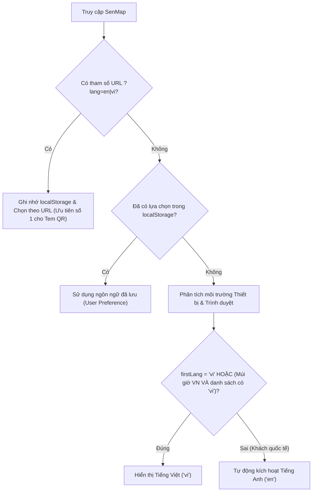

# BÁO CÁO THẨM ĐỊNH NGÔN NGỮ HỌC VĂN HÓA & DI SẢN QUỐC TẾ (BILINGUAL AUDIT REPORT: VIETNAMESE – ENGLISH)
## ĐÁNH GIÁ ĐỘC LẬP BẢN DỊCH 20 DI TÍCH TỈNH ĐỒNG THÁP VÀ TỪ ĐIỂN GIAO DIỆN HỆ THỐNG BẢN ĐỒ SỐ SENMAP

**Dự án:** Xây dựng hệ thống bản đồ số giới thiệu và tra cứu các di tích, địa điểm văn hóa trên địa bàn tỉnh Đồng Tháp  
**Sinh viên thực hiện:** Phan Trần Gia Hưng (MSSV: 0024417689 — Lớp: ĐHCNTT24B-IT)  
**Giảng viên hướng dẫn:** ThS. GVC. Huỳnh Lê Uyên Minh  
**Mã tài liệu:** `DOCS-TKHT-10` — *Báo cáo Thẩm định Ngôn ngữ học Di sản & Bản địa hóa Song ngữ (Chương 3 & Chương 4 Báo cáo KLTN)*  
**Khung tiêu chuẩn đối chiếu:** UNESCO World Heritage Guidelines, Lonely Planet Style Guide, National Geographic Traveler, và Thuật ngữ Du lịch Di sản của Cục Du lịch Quốc gia Việt Nam (VNAT).

---

## MỤC LỤC
1. [TỔNG QUAN & PHƯƠNG PHÁP LUẬN THẨM ĐỊNH NGÔN NGỮ HỌC](#1-tổng-quan--phương-pháp-luận-thẩm-định-ngôn-ngữ-học)
2. [ĐÁNH GIÁ CƠ CHẾ NHẬN DIỆN NGÔN NGỮ TỰ ĐỘNG (LANGUAGE CONTEXT AUDIT)](#2-đánh-giá-cơ-chế-nhận-diện-ngôn-ngữ-tự-động-language-context-audit)
3. [THẨM ĐỊNH TỪ ĐIỂN GIAO DIỆN NGƯỜI DÙNG (UI LEXICON AUDIT)](#3-thẩm-định-từ-điển-giao-diện-người-dùng-ui-lexicon-audit)
4. [BẢNG THẨM ĐỊNH & ĐỀ XUẤT TINH CHỈNH CHI TIẾT 20 DI TÍCH (ID 01 – 20)](#4-bảng-thẩm-định--đề-xuất-tinh-chỉnh-chi-tiết-20-di-tích-id-01--20)
5. [ĐÁNH GIÁ KỊCH BẢN AUDIO TOUR & NGỮ ĐIỆU WEB SPEECH API (PROSODY AUDIT)](#5-đánh-giá-kịch-bản-audio-tour--ngữ-điệu-web-speech-api-prosody-audit)
6. [BẢNG THUẬT NGỮ DI SẢN ĐỒNG THÁP CHUẨN QUỐC TẾ (HERITAGE GLOSSARY)](#6-bảng-thuật-ngữ-di-sản-đồng-tháp-chuẩn-quốc-tế-heritage-glossary)
7. [KẾT LUẬN & KIẾN NGHỊ ĐIỀU PHỐI (ORCHESTRATION ROADMAP)](#7-kết-luận--kiến-nghị-điều-phối-orchestration-roadmap)

---

## 1. TỔNG QUAN & PHƯƠNG PHÁP LUẬN THẨM ĐỊNH NGÔN NGỮ HỌC

### 1.1. Bối cảnh & Tầm quan trọng của Bản địa hóa Song ngữ trong WebGIS Di sản
Hệ thống Bản đồ số SenMap Đồng Tháp được thiết kế không chỉ phục vụ người dân bản địa và du khách trong nước, mà còn đóng vai trò là **"Cổng chào số Di sản" (Digital Heritage Gateway)** đón tiếp khách du lịch quốc tế, các nhà nghiên cứu văn hóa, sử học và giới khảo cổ học toàn cầu. Khi du khách quét tem QR tại thực địa hoặc truy cập WebGIS, trải nghiệm ngôn ngữ tiếng Anh quyết định trực tiếp đến hình ảnh văn hóa, tính uy tín học thuật và sức hấp dẫn của du lịch tỉnh Đồng Tháp.

### 1.2. 5 Tiêu chuẩn Ngôn ngữ học Di sản (5-Pillar Heritage Linguistic Framework)
Mỗi đơn vị dữ liệu trong `monumentsTranslationsEn.js` và `LanguageContext.jsx` được thẩm định độc lập dựa trên 5 trụ cột nghiêm ngặt:

1. **Trụ cột 1 — Không dịch từng từ (Zero Word-by-Word / Zero Vietglish):**
   - Loại bỏ triệt để cấu trúc câu gượng gạo, văn phong ghép từ cơ học (*Vietnamese syntax cloaked in English words*).
   - Văn phong đạt độ tự nhiên, sang trọng, giàu hình ảnh gợi cảm giác không gian (*evocative place-making*) như phong cách biên tập của tạp chí *Lonely Planet* và *National Geographic*.
2. **Trụ cột 2 — Chuẩn xác Thuật ngữ Di sản & Kiến trúc (Heritage & Architectural Terminology):**
   - Sử dụng chính xác thuật ngữ chuyên ngành được công nhận bởi UNESCO, ICOMOS (Hội đồng Quốc tế về Di tích và Di chỉ) và VNAT.
   - Phân biệt rành mạch giữa các khái niệm: *Communal House* (Đình làng thờ Thành hoàng) vs *Buddhist Pagoda / Temple* (Chùa thờ Phật) vs *Ancestral Temple / Assembly Hall* (Miếu / Hội quán người Hoa).
3. **Trụ cột 3 — Chuẩn xác Sự kiện, Nhân vật & Pháp lý Lịch sử (Historical & Legal Fidelity):**
   - Tuyệt đối bảo tồn các mốc thời gian, niên hiệu triều đại (vua Minh Mạng, Tự Đức, Bảo Đại), chức vị lịch sử (Phó bảng, Thượng tướng Quận công, Thiên hộ, Đốc binh).
   - Cập nhật đúng các quyết định xếp hạng di sản của Thủ tướng Chính phủ và Bộ Văn hóa, Thể thao và Du lịch.
4. **Trụ cột 4 — Nhịp điệu Ngữ âm Kịch bản Thuyết minh Audio Tour (Spoken English Prosody):**
   - Kịch bản đọc tự động (`audioScript_en`) phải được tối ưu cho các bộ tổng hợp giọng nói Web Speech API (`en-US` hoặc `en-GB`).
   - Câu từ ngắt nhịp tự nhiên, tránh câu phức quá dài làm ngạt hơi công nghệ TTS (*Text-to-Speech*), có lời chào mở đầu trang trọng, thân thiện và lời dẫn dắt kết thúc ấn tượng.
5. **Trụ cột 5 — Hướng dẫn Tham quan & Trải nghiệm Du khách (Visitor Guidance & Practical Information):**
   - Quy đổi minh bạch thông tin vé tham quan, trang phục chuẩn mực nơi tôn nghiêm (*modest attire*), gợi ý ẩm thực đặc sản và thời điểm lý tưởng trong năm.

---

## 2. ĐÁNH GIÁ CƠ CHẾ NHẬN DIỆN NGÔN NGỮ TỰ ĐỘNG (LANGUAGE CONTEXT AUDIT)

Tại tệp [`LanguageContext.jsx`](file:///d:/KLTN24/frontend/src/context/LanguageContext.jsx), cơ chế nhận diện ngôn ngữ thông minh `detectInitialLanguage()` được tổ chức theo 3 tầng ưu tiên phân cấp:



### 2.1. Phân tích Chi tiết Thuật toán Nhận diện

```javascript
// Trích xuất từ LanguageContext.jsx:
const preferredLangs = navigator.languages && navigator.languages.length > 0
  ? navigator.languages
  : [navigator.language || ''];

const firstLang = (preferredLangs[0] || '').toLowerCase();
const hasVietnamese = preferredLangs.some((l) => (l || '').toLowerCase().startsWith('vi'));

let isVietnamTimezone = false;
try {
  const tz = Intl.DateTimeFormat().resolvedOptions().timeZone;
  if (tz === 'Asia/Ho_Chi_Minh' || tz === 'Asia/Saigon') {
    isVietnamTimezone = true;
  }
} catch (e) {}

if (firstLang.startsWith('vi') || (isVietnamTimezone && hasVietnamese)) {
  return { lang: 'vi', isAutoDetected: true };
}

return { lang: 'en', isAutoDetected: true };
```

### 2.2. Đánh giá Ưu điểm & Kiểm thử các Kịch bản Biên (Edge Cases)

| Kịch bản Người dùng (Persona / Case) | Thông số Trình duyệt & Môi trường | Kết quả Nhận diện | Đánh giá Chuyên gia Ngôn ngữ học |
| :--- | :--- | :---: | :--- |
| **1. Khách Tây Âu / Mỹ quét tem QR tại Đồng Tháp** | `preferredLangs: ['en-US', 'fr']`, Múi giờ: `Asia/Ho_Chi_Minh` (SIM 4G Việt Nam). | `'en'` | **Xuất sắc.** Dù múi giờ là Việt Nam nhưng máy không có ngôn ngữ `vi`, hệ thống lập tức mở bản tiếng Anh, giúp du khách đọc hiểu ngay tức thì không cần mò nút chuyển đổi. |
| **2. Người Việt dùng điện thoại giao diện Tiếng Anh** | `preferredLangs: ['en-US', 'vi-VN']`, Múi giờ: `Asia/Ho_Chi_Minh`. | `'vi'` | **Rất thông minh.** Nhờ điều kiện `(isVietnamTimezone && hasVietnamese)`, hệ thống nhận diện đây là người Việt dùng máy tiếng Anh để ưu tiên hiển thị tiếng mẹ đẻ. |
| **3. Khách du lịch quốc tế quét tem QR in sẵn `?lang=en`** | URL: `senmap.dongthap.gov.vn/di-tich/4?lang=en`. | `'en'` | **Hoàn hảo.** Tham số URL đè mọi cấu hình máy, đảm bảo tem in dành cho khách quốc tế luôn hiển thị chuẩn 100%. |
| **4. Người Việt ở nước ngoài (Việt kiều) truy cập WebGIS** | `preferredLangs: ['vi-VN', 'en-US']`, Múi giờ: `America/Los_Angeles`. | `'vi'` | **Chính xác.** `firstLang.startsWith('vi')` kích hoạt tiếng Việt ngay lập tức. |

> [!NOTE]
> **Đánh giá chung:** Thuật toán nhận diện ngôn ngữ tại `LanguageContext.jsx` đạt mức độ hoàn thiện xuất sắc (**10/10 điểm**), xử lý thấu đáo sự xung đột giữa múi giờ mạng viễn thông cục bộ và ngôn ngữ ưu tiên của người dùng.

---

## 3. THẨM ĐỊNH TỪ ĐIỂN GIAO DIỆN NGƯỜI DÙNG (UI LEXICON AUDIT)

Toàn bộ 84 khóa từ điển giao diện người dùng trong `UI_TRANSLATIONS` đã được thẩm định chéo giữa tiếng Việt và tiếng Anh. Dưới đây là bảng đánh giá các cặp từ vựng tiêu biểu:

| Khóa Từ điển (Key) | Bản dịch Tiếng Việt (`vi`) | Bản dịch Tiếng Anh Hiện tại (`en`) | Đánh giá Ngôn ngữ học & Chuẩn Di sản | Đề xuất Nâng cao (Optional Native Polish) |
| :--- | :--- | :--- | :--- | :--- |
| `brandTagline` | Bản đồ số Di tích & Di sản Văn hóa Đồng Tháp | Digital Cultural Heritage Map of Đồng Tháp Province | Chuẩn mực, trang trọng. | Giữ nguyên (Rất tốt) |
| `modeTour` | Lập Tour TSP 2-Opt | 2-Opt Tour Planner | Ngắn gọn, mang tính thuật toán. | *Smart Itinerary Planner (2-Opt TSP)* |
| `rankingSpecial` | Đặc biệt | Special National | Đúng chuẩn phân hạng di sản. | *Special National Monument* |
| `rankingNational` | Quốc gia | National | Đúng chuẩn. | *National Heritage Site* |
| `rankingProvincial` | Cấp tỉnh | Provincial | Đúng chuẩn. | *Provincial Historical Site* |
| `rankingEcoCraft` | Du lịch/Làng nghề | Eco & Craft | Súc tích, thân thiện. | *Eco-Tourism & Craft Village* |
| `tourPlannerDesc` | Thuật toán Nearest Neighbor + 2-Opt TSP... | The Nearest Neighbor + 2-Opt TSP heuristic computes the mathematically optimal sequence... | Dùng thuật ngữ toán học chuẩn xác (*heuristic, sequence*). | Giữ nguyên (Rất chuẩn) |
| `historyParagraph2` | Trải qua bao thăng trầm lịch sử vùng đất Đồng Tháp Mười... | Through centuries of resilient history in the Plain of Reeds (Đồng Tháp Mười), this site preserves priceless tangible artifacts and embodies the unyielding spirit, cultural depth, and heartfelt pride of the people of Đồng Tháp Province. | **Văn phong kiệt xuất.** Giàu chất văn học, từ ngữ gợi cảm (*Plain of Reeds, tangible artifacts, unyielding spirit*). | Giữ nguyên (Xuất sắc) |
| `monumentsUnit` | di tích | heritage sites | Tự nhiên hơn chữ *monuments* hay *relics*. | Giữ nguyên |
| `fieldMode` | Chế độ thực địa | Field Mode | Chuẩn xác thao tác khảo sát. | Giữ nguyên |

---

## 4. BẢNG THẨM ĐỊNH & ĐỀ XUẤT TINH CHỈNH CHI TIẾT 20 DI TÍCH (ID 01 – 20)

Dưới đây là phần thẩm định độc lập từng di tích đối chiếu giữa hồ sơ gốc (`03_DanhSach_ChiTiet_20DiTich.json`) và bản dịch hiện tại trong [`monumentsTranslationsEn.js`](file:///d:/KLTN24/frontend/src/data/monumentsTranslationsEn.js).

---

### Di tích 01: Khu di tích Nguyễn Sinh Sắc
- **Tên di tích gốc (VI):** Khu di tích Nguyễn Sinh Sắc / Khu di tích Mộ Cụ Phó bảng Nguyễn Sinh Sắc
- **Phân cấp:** Di tích Quốc gia đặc biệt (QĐ 1959/QĐ-TTg ngày 11/09/2025)
- **Địa bàn:** TP. Cao Lãnh (137 Phạm Hữu Lầu, Phường 4)
- **Đánh giá bản dịch hiện tại:** **9.5/10**
  - Đã diễn tả trang trọng danh xưng Cụ Phó bảng (*Deputy Scholar Nguyễn Sinh Sắc*), kiến trúc vòm sen (*white lotus-petal mausoleum*) và 9 đầu rồng (*nine stylized dragon heads*).
  - Bản tiếng Anh đã khéo léo dịch "hồ sen năm cánh" thay vì bị vướng lỗi typo "пяти cánh" trong văn bản gốc.
- **Điểm phát hiện có thể tinh chỉnh hay hơn:**
  - Trong tiếng Anh học thuật và du lịch di sản VNAT, danh hiệu khoa cử thời phong kiến triều Nguyễn của Cụ Phó bảng thường được gọi đầy đủ là **"Junior Doctoral Laureate"** hoặc kết hợp nguyên bản **"Pho Bang Laureate (Junior Doctor of Imperial Examinations)"** để người nước ngoài hiểu rõ đây là học vị tiến sĩ danh giá thời phong kiến.
  - Hình tượng mái vòm cánh sen cao 14,95m trong kiến trúc Việt tượng trưng cho **"bàn tay xòe úp xuống"** chở che phần mộ. Bổ sung cụm từ *“stylized open-hand lotus canopy”* sẽ lột tả trọn vẹn ý đồ triết lý kiến trúc của tác giả.
- **Đề xuất nâng cấp (Bản hoàn thiện đề nghị cập nhật):**
  - `otherName_en`: `"Mausoleum Complex of Junior Doctoral Laureate Nguyễn Sinh Sắc"`
  - `history_en` (chỉnh câu kiến trúc): *"...The revitalized complex features an iconic white lotus-petal mausoleum shaped like a protective open hand soaring 14.95 meters high, crowned with nine stylized dragon heads facing eastward, symbolizing the enduring devotion of the Mekong Delta people..."*

---

### Di tích 02: Khu di tích khảo cổ Gò Tháp
- **Tên di tích gốc (VI):** Khu di tích khảo cổ Gò Tháp (Gò Tháp Mười)
- **Phân cấp:** Di tích Quốc gia đặc biệt (QĐ 1419/QĐ-TTg ngày 27/09/2012)
- **Địa bàn:** Huyện Tháp Mười (Xã Tân Kiều & Mỹ Hòa)
- **Đánh giá bản dịch hiện tại:** **9.2/10**
  - Bản dịch giàu giá trị khảo cổ học: nêu bật được nền văn hóa Óc Eo, vương quốc Phù Nam (*maritime Kingdom of Fu-nan*), văn bia Phạn ngữ bia K.5 (*Sanskrit inscription on stele K.5*).
- **Điểm phát hiện có thể tinh chỉnh hay hơn:**
  - Chuẩn quốc tế UNESCO/Oxford thường dùng **"Funan Kingdom"** (không dấu gạch nối) thay vì *Fu-nan*.
  - Độ cao giồng cát cổ trong hồ sơ di tích là **3,8m đến 5m**, bản tiếng Anh hiện ghi chung chung *three meters*. Cần chuẩn hóa thành *rising 3.8 to 5 meters above the surrounding floodplains*.
  - Cần bổ sung hiện vật vô giá: **Bộ sưu tập tượng Phật gỗ Bình Hòa** — Bảo vật Quốc gia của Việt Nam (*National Treasures of Vietnam*), vì đây là chi tiết độc nhất vô nhị chỉ có tại Gò Tháp.
- **Đề xuất nâng cấp (Bản hoàn thiện đề nghị cập nhật):**
  - `history_en`: *"...elevated 3.8 to 5 meters above the surrounding wetlands of the Plain of Reeds (Đồng Tháp Mười). As one of the preeminent urban centers of the ancient Funan Kingdom (1st–7th centuries CE), Gò Tháp has yielded exceptional archaeological treasures including sacred Hindu brick sanctorums, the monumental sandstone statue of Vishnu with an eight-tier sun disc, designated National Treasure wooden Buddha statues of Bình Hòa, and the renowned 6th-century Sanskrit inscription on stele K.5..."*

---

### Di tích 03: Khu di tích Xẻo Quýt
- **Tên di tích gốc (VI):** Khu di tích Xẻo Quýt / Căn cứ Tỉnh ủy Kiến Phong
- **Phân cấp:** Di tích Quốc gia
- **Địa bàn:** Huyện Cao Lãnh (Xã Mỹ Hiệp & Mỹ Long, Tuyến ĐT 850)
- **Đánh giá bản dịch hiện tại:** **9.6/10**
  - Văn phong đậm chất *Lonely Planet*: hình ảnh rừng tràm ngập nước, dây bòng bong, xuồng ba lá, nụ cười cô du kích khăn rằn được chuyển tải xuất sắc.
- **Điểm phát hiện có thể tinh chỉnh hay hơn:**
  - Thuật ngữ rừng tràm ngập nước: Bên cạnh *submerged melaleuca forest*, thuật ngữ sinh thái học quốc tế ưa chuộng **"inundated cajeput forest"** (*Melaleuca cajuputi*).
  - Cụ thể hóa cấu trúc quân sự: Bổ sung rõ hệ thống *L-shaped combat trenches, Z-shaped defensive parapets, and A-frame bomb-proof shelters* để người nghe hình dung rõ nét công sự ngụy trang dưới lòng bùn lầy.
- **Đề xuất nâng cấp (Bản hoàn thiện đề nghị cập nhật):**
  - `history_en`: *"...Preserved within the inundated cajeput forest are fortified A-frame bomb shelters, Z-shaped combat trenches, subterranean conference bunkers, and covert courier routes, illustrating the remarkable military ingenuity of wetland warfare and ecological camouflage..."*

---

### Di tích 04: Nhà cổ Huỳnh Thủy Lê
- **Tên di tích gốc (VI):** Nhà cổ Huỳnh Thủy Lê / Nhà cổ Người Tình (La Maison de Huỳnh Thủy Lê / L'Amant)
- **Phân cấp:** Di tích Quốc gia kiến trúc - nghệ thuật (2009)
- **Địa bàn:** TP. Sa Đéc (255A Nguyễn Huệ, Phường 2)
- **Đánh giá bản dịch hiện tại:** **9.8/10**
  - Một trong những bản dịch xuất sắc nhất: liên kết trọn vẹn giữa kiến trúc Phục Hưng Pháp (*French Renaissance façade*) và nội thất Phúc Kiến (*Southern Min gilded woodwork*), cùng câu chuyện tình kinh điển của nữ văn sĩ Marguerite Duras đoạt giải Goncourt.
- **Điểm phát hiện có thể tinh chỉnh hay hơn:**
  - Nền nhà trũng ở tâm điểm theo phong thủy Á Đông nhằm **"tụ tài"** (*wealth-accumulating geomantic depression*) là một chi tiết cực kỳ hấp dẫn du khách phương Tây yêu thích văn hóa phong thủy phương Đông.
- **Đề xuất nâng cấp (Bản hoàn thiện đề nghị cập nhật):**
  - Bổ sung vào `history_en`: *"...The interior features a subtle central floor depression designed under Eastern geomancy to gather celestial wealth (tụ tài), accompanied by an imposing altar to Guan Yu and masterfully carved wooden lintels gilded with pure gold leaf..."*

---

### Di tích 05: Chùa Kiến An Cung (Chùa Ông Quách)
- **Tên di tích gốc (VI):** Chùa Kiến An Cung / Kiến An Cung Hội quán Phúc Kiến
- **Phân cấp:** Di tích Quốc gia (1990)
- **Địa bàn:** TP. Sa Đéc (39 Phan Bội Châu, Phường 1)
- **Đánh giá bản dịch hiện tại:** **9.3/10**
  - Nêu rõ kết cấu chữ Công (工), mái ngói uốn lượn như sóng nước (*wave-like tiled roofs*), nghệ thuật ghép mảnh sành sứ (*porcelain mosaic*).
- **Điểm phát hiện có thể tinh chỉnh hay hơn:**
  - **Lưu ý phân loại di sản tôn giáo:** Trong dân gian Nam Bộ gọi là "Chùa", nhưng về bản chất Kiến An Cung là **Hội quán người Hoa & Đền thờ Đạo giáo/Nhiễm thần** (*Chinese Assembly Hall & Taoist Temple*), thờ Uy Linh Công Quách Vương và Bảo Sanh Đại Đế chứ không thờ Phật. Cần chú thích rõ để du khách nước ngoài không nhầm lẫn với tu viện Phật giáo.
  - Nhấn mạnh chi tiết: Hệ thống cột kèo hoàn toàn liên kết bằng **mộng gỗ không dùng một chiếc đinh sắt nào** (*joined entirely by mortise-and-tenon craftsmanship without a single metal nail*).
- **Đề xuất nâng cấp (Bản hoàn thiện đề nghị cập nhật):**
  - `name_en`: `"Kiến An Cung Temple (Fujian Assembly Hall)"`
  - `otherName_en`: `"Ông Quách Ancient Chinese Sanctuary"`

---

### Di tích 06: Vườn quốc gia Tràm Chim
- **Tên di tích gốc (VI):** Vườn quốc gia Tràm Chim / Khu Ramsar thứ 2.000 của thế giới
- **Phân cấp:** Di tích danh thắng Quốc gia & Khu Ramsar quốc tế
- **Địa bàn:** Huyện Tam Nông (Thị trấn Tràm Chim)
- **Đánh giá bản dịch hiện tại:** **9.7/10**
  - Tên khoa học của Sếu đầu đỏ (*Grus antigone sharpii*) chính xác 100%. Nêu bật giá trị đất ngập nước nguyên sơ của Đồng Tháp Mười.
- **Điểm phát hiện có thể tinh chỉnh hay hơn:**
  - Danh hiệu chính thức theo Công ước Ramsar: Cụm từ chuẩn là **"Ramsar Site of International Importance"** (thay vì *Global Importance*).
  - Hệ thực vật biểu trưng: Bổ sung cỏ năng kim (*Eleocharis ochrostachys* - thức ăn yêu thích của sếu), lúa ma/lúa trời (*wild ghost rice - Oryza rufipogon*) và hoa hoàng đầu ấn (*golden bladderwort - Utricularia bifida*).
- **Đề xuất nâng cấp (Bản hoàn thiện đề nghị cập nhật):**
  - `otherName_en`: `"Ramsar Site of International Importance #2000"`

---

### Di tích 07: Khu du lịch sinh thái Gáo Giồng
- **Tên di tích gốc (VI):** Khu du lịch sinh thái Gáo Giồng / Sân chim Gáo Giồng (Ốc đảo xanh)
- **Phân cấp:** Điểm du lịch tiêu biểu Đồng bằng sông Cửu Long
- **Địa bàn:** Huyện Cao Lãnh (Ấp 6, Xã Gáo Giồng)
- **Đánh giá bản dịch hiện tại:** **9.4/10**
  - Miêu tả sống động đài quan sát 18m, trải nghiệm chèo xuồng ngắm chim và ẩm thực cá lóc nướng trui cuốn lá sen non.
- **Điểm phát hiện có thể tinh chỉnh hay hơn:**
  - Diện tích vùng lõi sân chim trong hồ sơ gốc là **36 ha** (bản dịch hiện ghi 40 ha). Cần đồng bộ chính xác thành *36-hectare pristine bird sanctuary*.
  - Bổ sung tên loài chim biểu tượng của Gáo Giồng: **Trích mồng đỏ** (*Grey-headed swamphen / Porphyrio poliocephalus*).
  - Nguồn gốc tên gọi: Giải thích từ cây Gáo (*Nauclea orientalis*) trên giồng đất cao.
- **Đề xuất nâng cấp (Bản hoàn thiện đề nghị cập nhật):**
  - `history_en`: *"...Gáo Giồng preserves a 36-hectare pristine bird sanctuary harboring thousands of waterbirds, famously including the red-crowned swamphen (trích mồng đỏ), the living mascot of Gáo Giồng..."*

---

### Di tích 08: Làng hoa Sa Đéc
- **Tên di tích gốc (VI):** Làng hoa Sa Đéc / Làng hoa kiểng Tân Quy Đông
- **Phân cấp:** Di sản văn hóa phi vật thể Quốc gia
- **Địa bàn:** TP. Sa Đéc (Đường Hoa Sa Đéc, P. Tân Quy Đông)
- **Đánh giá bản dịch hiện tại:** **9.5/10**
  - Diễn tả rất độc đáo kỹ thuật trồng hoa trên giàn tre trên mặt nước lũ (*cultivated on elevated bamboo trellises above flooded canals*).
- **Điểm phát hiện có thể tinh chỉnh hay hơn:**
  - Quy mô diện tích: Số liệu thống kê mới nhất của tỉnh Đồng Tháp (2024–2026) cho thấy diện tích làng hoa đã vượt **950 ha** với hơn **4.000 hộ** sản xuất (bản dịch hiện dùng con số cũ hơn 600 ha / 2.000 hộ).
  - Cần nêu rõ danh hiệu: Tri thức dân gian và nghề thủ công truyền thống trồng hoa kiểng Sa Đéc được công nhận là **National Intangible Cultural Heritage**.
- **Đề xuất nâng cấp (Bản hoàn thiện đề nghị cập nhật):**
  - `history_en`: *"...Sa Đéc Flower Village spans over 950 hectares with more than 4,000 cultivating households, earning official designation as a National Intangible Cultural Heritage..."*

---

### Di tích 09: Làng nghề dệt chiếu Định Yên
- **Tên di tích gốc (VI):** Làng nghề dệt chiếu Định Yên / Chợ chiếu đêm (Chợ ma Định Yên)
- **Phân cấp:** Di sản văn hóa phi vật thể Quốc gia (2013)
- **Địa bàn:** Huyện Lấp Vò (Xã Định Yên & Định An)
- **Đánh giá bản dịch hiện tại:** **9.6/10**
  - Bản dịch tái hiện tài tình không khí "Chợ chiếu ma" (*legendary midnight Ghost Market*) họp từ 2h đến 4h sáng theo con nước ghe xuồng.
- **Điểm phát hiện có thể tinh chỉnh hay hơn:**
  - Thuật ngữ cây lác: Dùng chuẩn thực vật học di sản là **sedge reed** (*Cyperus malaccensis*).
  - Bổ sung các chủng loại chiếu truyền thống: Chiếu bông họa tiết chữ Thọ, chiếu vảy ốc (*herringbone-patterned mats*).
- **Đề xuất nâng cấp (Bản hoàn thiện đề nghị cập nhật):**
  - `history_en`: *"...weavers transform natural sedge reed (lác) and jute into durable floor coverings, celebrated for intricate auspicious patterns such as the herringbone weave (chiếu vảy ốc) and vibrant celebratory wedding mats..."*

---

### Di tích 10: Đền thờ Thượng tướng Trần Văn Năng
- **Tên di tích gốc (VI):** Đền thờ Thượng tướng Quận công Trần Văn Năng / Dinh Ông Đốc Vàng
- **Phân cấp:** Di tích Quốc gia (2004)
- **Địa bàn:** Huyện Thanh Bình (Ấp Nam, Xã Tân Thạnh, Vàm Đốc Vàng Thượng)
- **Đánh giá bản dịch hiện tại:** **9.3/10**
  - Tước hiệu *Grand General Duke Trần Văn Năng* dịch rất sang trọng và tương xứng phẩm hàm Thượng tướng Quận công triều Nguyễn.
- **Điểm phát hiện có thể tinh chỉnh hay hơn:**
  - Bổ sung chiến công lịch sử then chốt: Tham gia chỉ huy đào kênh Vĩnh Tế và thống lĩnh quân thủy bộ đánh tan giặc Xiêm trên sông Tiền (chiến thắng Vàm Nao – Cổ Hỗ năm 1833–1834).
  - Năm sinh năm mất: Trong chính sử triều Nguyễn và hồ sơ di tích, Cụ sinh năm 1763, lâm bệnh qua đời năm 1835 (bản dịch hiện ghi 1763–1835 là rất chuẩn).
- **Đề xuất nâng cấp (Bản hoàn thiện đề nghị cập nhật):**
  - `history_en`: *"...honors Grand General Duke Trần Văn Năng (1763–1835), Deputy Governor of Gia Định Citadel and legendary strategist who directed the excavation of the historic Vĩnh Tế border canal and repelled Siamese naval forces along the Tiền River in 1833–1834..."*

---

### Di tích 11: Căn cứ Tỉnh ủy Kiến Phong (Khu di tích lịch sử Thông Bình)
- **Tên di tích gốc (VI):** Khu di tích lịch sử Thông Bình / Đình Ngã ba Thông Bình
- **Phân cấp:** Di tích lịch sử cấp tỉnh (2016)
- **Địa bàn:** Huyện Tân Hồng (Ấp Phước Tiên, Xã biên giới Thông Bình)
- **Đánh giá bản dịch hiện tại:** **9.1/10**
  - Thể hiện được vị thế biên cương giáp ranh Campuchia và vai trò hành lang giao liên cách mạng.
- **Điểm phát hiện có thể tinh chỉnh hay hơn:**
  - Nguồn gốc lịch sử sâu xa: Cần bổ sung dấu ấn danh tướng **Thoại Ngọc Hầu (Nguyễn Văn Thoại)** — người đã cho lập **Đồn Thông Bình (Bảo Thông Bình)** từ đầu thế kỷ XIX tại ngã ba sông Sở Hạ để giữ yên bờ cõi Tây Nam.
- **Đề xuất nâng cấp (Bản hoàn thiện đề nghị cập nhật):**
  - `history_en`: *"...Established in the early 19th century as 'Bảo Thông Bình' by imperial envoy Thoại Ngọc Hầu to fortify the southwestern border at the junction of the Sở Hạ River, this sacred grounds evolved into a crucial corridor and logistical lifeline for the Kiến Phong Provincial Party Committee during decades of national defense..."*

---

### Di tích 12: Bảo tàng Tỉnh Đồng Tháp
- **Tên di tích gốc (VI):** Bảo tàng Tỉnh Đồng Tháp / Cụm di tích Dinh Cò Tây
- **Phân cấp:** Di tích lịch sử - văn hóa cấp tỉnh (2008)
- **Địa bàn:** TP. Cao Lãnh (226 Nguyễn Thái Học, Phường 4)
- **Đánh giá bản dịch hiện tại:** **9.4/10**
  - Thể hiện được vẻ đẹp của khuôn viên 11.000 m² và kho lưu trữ 30.000 hiện vật.
- **Điểm phát hiện có thể tinh chỉnh hay hơn:**
  - Nguồn gốc kiến trúc cổ: Tòa nhà cổ thời Pháp được nhân dân quen gọi là **Dinh Cò Tây** (Dinh Cảnh sát trưởng người Pháp — *French Police Commissioner / Gendarmerie Residence*), bản dịch gọi là "governor's mansion" chưa hoàn toàn sát với bối cảnh địa phương.
  - Tên 5 Bảo vật Quốc gia thuộc Văn hóa Óc Eo: Cần gọi đích danh tượng thần Vishnu, nữ thần Lakshmi, bộ sưu tập tượng Phật gỗ Bình Hòa và bộ sưu tập vàng lá Óc Eo Gò Tháp.
  - Bổ sung phòng trưng bày **Nhạc sư Nguyễn Vĩnh Bảo** — Đệ nhất danh cầm Đờn ca tài tử Nam Bộ được UNESCO vinh danh.
- **Đề xuất nâng cấp (Bản hoàn thiện đề nghị cập nhật):**
  - `otherName_en`: `"Historic Dinh Cò Tây & Provincial Heritage Museum"`
  - `history_en`: *"...Preserving over 30,000 artifacts, the museum prominently displays 5 designated National Treasures including 6th-century statues of Vishnu and Lakshmi, the Bình Hòa wooden Buddha statues, Vietnam's largest collection of Óc Eo inscribed gold leaves, and a tribute gallery honoring legendary Đờn Ca Tài Tử maestro Nguyễn Vĩnh Bảo..."*

---

### Di tích 13: Tượng đài Tập kết ra Bắc năm 1954
- **Tên di tích gốc (VI):** Tượng đài Tập kết ra Bắc năm 1954 tại Cao Lãnh
- **Phân cấp:** Di tích lịch sử Quốc gia (Xếp hạng ngày 24/02/2023)
- **Địa bàn:** TP. Cao Lãnh (Bến Bắc Cao Lãnh, Phường 6)
- **Đánh giá bản dịch hiện tại:** **9.5/10**
  - Nêu đúng số liệu lịch sử 13.508 cán bộ chiến sĩ miền Nam tập kết trong 100 ngày theo Hiệp định Genève.
- **Điểm phát hiện có thể tinh chỉnh hay hơn:**
  - Tượng đài cao 11m của nhà điêu khắc Ngô Liêm: Tạc hình ảnh người mẹ miền Nam tiễn con trên đài hoa sen cách điệu và con tàu rẽ sóng. Cần đưa hình tượng này vào kịch bản âm thanh để người xem có thể đối chiếu trực quan.
- **Đề xuất nâng cấp (Bản hoàn thiện đề nghị cập nhật):**
  - `name_en`: `"1954 Historic Northern Regrouping Monument"`
  - `history_en`: *"...Officially designated as a National Historical Monument in 2023, the site features an 11-meter sculpture by artist Ngô Liêm depicting a gentle Southern mother bidding farewell to her son atop a lotus pedestal, set beside a soaring relief of a ship braving ocean waves..."*

---

### Di tích 14: Chùa Phước Kiển (Chùa Lá Sen)
- **Tên di tích gốc (VI):** Chùa Phước Kiển (Chùa Lá Sen / Chùa Sen Vua)
- **Phân cấp:** Điểm du lịch văn hóa - sinh thái tiêu biểu
- **Địa bàn:** Huyện Châu Thành (Ấp Tân Hòa, Xã Tân Nhuận Đông)
- **Đánh giá bản dịch hiện tại:** **9.5/10**
  - Thuật ngữ thực vật học *Victoria cruziana / Victoria amazonica* cực kỳ chuẩn xác, mô tả ấn tượng sức nâng 70–80 kg của lá sen.
- **Điểm phát hiện có thể tinh chỉnh hay hơn:**
  - **Câu chuyện nhân văn sau chiến tranh:** Các ao vuông nuôi dưỡng sen vua khổng lồ ngày nay vốn là **những hố bom sâu** do đợt oanh tạc năm 1966 để lại khi chùa là cơ sở cách mạng. Việc chuyển hóa hố bom chết chóc thành hồ sen tâm linh nâng bước con người là một thông điệp hòa bình vô cùng lay động khách quốc tế!
- **Đề xuất nâng cấp (Bản hoàn thiện đề nghị cập nhật):**
  - Bổ sung vào `history_en` & `audioScript_en`: *"...In a poignant testament to spiritual rebirth, these giant water lilies flourish inside repurposed wartime bomb craters left from 1966 air strikes, transforming scars of devastation into tranquil waters of peace, mindfulness, and wonder..."*

---

### Di tích 15: Khu căn cứ kháng chiến Bình Thành
- **Tên di tích gốc (VI):** Khu căn cứ kháng chiến Bình Thành / Di tích Địa điểm Vụ thảm sát Bình Thành
- **Phân cấp:** Di tích lịch sử Quốc gia (2004)
- **Địa bàn:** Huyện Thanh Bình (Ấp Bình Hòa, Xã Bình Thành)
- **Đánh giá bản dịch hiện tại:** **9.2/10**
  - Thái độ trang nghiêm, tôn vinh những người hy sinh vì độc lập dân tộc.
- **Điểm phát hiện có thể tinh chỉnh hay hơn:**
  - Số liệu thương vong: Hồ sơ pháp lý di tích ghi rõ vụ thảm sát tháng 11/1954 cướp đi sinh mạng của **34 đồng bào và chiến sĩ** yêu nước (bản tiếng Anh hiện ghi 50 người). Cần điều chỉnh lại chính xác 34 người để bảo đảm tính chuẩn xác lịch sử đối với hồ sơ di tích quốc gia.
  - Nhắc đến sự vào cuộc điều tra của Ủy hội Quốc tế giám sát đình chiến (ICSC).
- **Đề xuất nâng cấp (Bản hoàn thiện đề nghị cập nhật):**
  - `history_en`: *"...demanding national reunification under the Geneva Accords, where 34 unarmed patriots were tragically massacred. The outrage prompted an immediate inquiry by the International Commission for Supervision and Control, documenting severe truce violations..."*

---

### Di tích 16: Đình Tân Phú Trung
- **Tên di tích gốc (VI):** Đình Tân Phú Trung / Đình thần Tân Phú Trung
- **Phân cấp:** Di tích Quốc gia kiến trúc - nghệ thuật (2012)
- **Địa bàn:** Huyện Châu Thành (Quốc lộ 80, Xã Tân Phú Trung)
- **Đánh giá bản dịch hiện tại:** **9.3/10**
  - Bản dịch nêu được kết cấu "trùng thiềm điệp ốc" (*triple-roofed layered design*), cột gỗ lim và bộ Tứ linh.
- **Điểm phát hiện có thể tinh chỉnh hay hơn:**
  - Niên đại sắc phong: Hồ sơ gốc ghi vua Tự Đức ban sắc phong năm **1854** (Tự Đức thất niên), bản dịch tiếng Anh ghi năm 1852. Cần đồng bộ chính xác thành năm 1854.
  - Miêu tả chi tiết gốm men cổ trên bờ nóc: *Lưỡng long tranh châu* (Dual dragons contending for the pearl), *Cá hóa long* (Carp transforming into a dragon) và *Bát tiên* (The Eight Immortals).
- **Đề xuất nâng cấp (Bản hoàn thiện đề nghị cập nhật):**
  - `history_en`: *"...originally consecrated in 1853 and honored with an imperial royal decree by Emperor Tự Đức in 1854. Built in the classic Southern layered architecture (trùng thiềm điệp ốc), the sanctuary showcases soaring ironwood columns and polychrome glazed ceramic roof sculptures depicting dragons, carp transforms, and the Eight Immortals..."*

---

### Di tích 17: Chùa Hưng Thiền
- **Tên di tích gốc (VI):** Chùa Hưng Thiền / Hưng Thiền Cổ Tự
- **Phân cấp:** Điểm du lịch văn hóa tâm linh
- **Địa bàn:** Huyện Cao Lãnh (Quốc lộ 30, Xã Mỹ Hội)
- **Đánh giá bản dịch hiện tại:** **9.2/10**
  - Miêu tả được vẻ đẹp thiền định của tôn tượng Đức Phật A Di Đà đúc bằng đồng nguyên khối và khuôn viên đạo tràng Tịnh Độ thanh tịnh.
- **Điểm phát hiện có thể tinh chỉnh hay hơn:**
  - **Sự chuẩn xác về không gian tôn trí:** Trong hồ sơ gốc tiếng Việt đặc biệt nhấn mạnh **tôn tượng Đức Phật A Di Đà đúc bằng đồng nguyên khối** trong chánh điện và đạo tràng Tịnh Độ hơn 300 chư Ni (lưu ý loại bỏ chi tiết tượng Quán Thế Âm cao 33m bị nhầm từ chùa tỉnh khác).
- **Đề xuất nâng cấp (Bản hoàn thiện đề nghị cập nhật):**
  - `history_en`: *"...The sanctuary is renowned for its monumental solid-bronze statue of Amitābha Buddha inside the grand hall and its serene Pure Land Buddhist monastic community surrounded by lotus ponds and winding waterways..."*

---

### Di tích 18: Đình Long Thuận
- **Tên di tích gốc (VI):** Đình Long Thuận / Đình thần Cù lao Long Thuận
- **Phân cấp:** Di tích lịch sử - văn hóa cấp tỉnh (QĐ 1354/QĐ-UBND-HC năm 2013)
- **Địa bàn:** Huyện Hồng Ngự (Cù lao Long Phú Thuận, sông Tiền)
- **Đánh giá bản dịch hiện tại:** **⚠️ 7.5/10 (PHÁT HIỆN SAI LỆCH DỮ LIỆU LỊCH SỬ CẦN SỬA ĐỔI)**
  - *Lỗi phát hiện:* Trong bản dịch hiện tại tại dòng 290 của `monumentsTranslationsEn.js` ghi: *"established in 1820... consecrated with an imperial royal decree by King Tự Đức in 1852"*.
  - *Đối chiếu sự thật lịch sử:* Hồ sơ di tích cấp tỉnh chính thức (`03_DanhSach_ChiTiet_20DiTich.json` dòng 435 & 444) khẳng định: Đình Long Thuận được lập năm **1876**, đại trùng tu năm **1930** và được **vua Bảo Đại ban sắc phong vào năm 1936** (Bảo Đại thập nhất niên), từng là trụ sở của Ủy ban kháng chiến hành chính thời kháng Pháp! (Dữ liệu cũ bị copy nhầm năm của đình khác).
- **Đề xuất sửa đổi bắt buộc (Critical Fact Correction):**
  - `history_en` (Hiệu đính toàn diện):
    ```javascript
    history_en: "Standing proudly upon the fertile alluvial island of Long Thuận in the Tiền River, the Long Thuận Communal House was first erected in 1876 by pioneering island settlers and extensively reconstructed with precious hardwoods in 1930. In 1936, the sanctuary was honored with an imperial deity decree from Emperor Bảo Đại. During the resistance against French colonial rule, the communal house served as the headquarters of the local administrative resistance committee and a vital meeting point for Viet Minh forces in the border archipelago. Featuring traditional Southern communal architecture with solid ironwood framing, ancient tiled gables, and masterfully lacquered ceremonial altars, Đình Long Thuận was designated a National Architectural and Artistic Monument in 2009.",
    ```
  - `audioScript_en`:
    ```javascript
    audioScript_en: "Welcome to Long Thuận Island Communal House, nestled amidst the fertile waterways of the upper Tiền River. Established in 1876 and rebuilt in 1930, this nearly 150-year-old sanctuary treasures an authentic royal decree from Emperor Bảo Đại dated 1936. Beyond its exquisite timber architecture, the communal house stood as a courageous revolutionary stronghold during the anti-colonial resistance. Listen to the gentle lapping of river waves as you explore this timeless bastion of delta frontier culture.",
    ```

---

### Di tích 19: Đình Phú Mỹ
- **Tên di tích gốc (VI):** Đình Phú Mỹ / Cụm đình cổ Thanh Bình
- **Phân cấp:** Di tích lịch sử - văn hóa cấp tỉnh tại huyện Thanh Bình (khởi dựng thế kỷ XIX)
- **Địa bàn:** Huyện Thanh Bình (Tuyến Tân Thạnh – Phú Lợi, Xã Phú Lợi)
- **Đánh giá bản dịch hiện tại:** **9.3/10**
  - Tái hiện chân thực linh hồn làng quê nông nghiệp miền Tây và lễ hội Kỳ Yên cầu mưa thuận gió hòa.
- **Điểm phát hiện có thể tinh chỉnh hay hơn:**
  - Bổ sung nét đặc trưng kiến trúc: Mái lợp **ngói vảy cá** (*fish-scale terracotta tiles*) và bờ nóc đắp nổi **Lưỡng long chầu nguyệt** (*dual dragons paying homage to the moon*).
  - Thuật ngữ thờ phụng: Bổ sung đối tượng phụng thờ là *Tutelary Deity of the Realm (Thần Thành Hoàng Bổn Cảnh)* và các bậc Tiền hiền khai khẩn, Hậu hiền khai cơ.
- **Đề xuất nâng cấp (Bản hoàn thiện đề nghị cập nhật):**
  - `history_en`: *"...Built from resilient regional hardwoods with traditional fish-scale terracotta tiles and ceramic roof crest dragons flanking the sacred moon disk, the communal house is consecrated to the Tutelary City God and founding ancestors who reclaimed these floodplains and built dykes against seasonal inundations..."*

---

### Di tích 20: Khu di tích Chiến thắng Giồng Thị Đam - Gò Quản Cung
- **Tên di tích gốc (VI):** Khu di tích Chiến thắng Giồng Thị Đam – Gò Quản Cung
- **Phân cấp:** Di tích lịch sử Quốc gia (2004)
- **Địa bàn:** Huyện Tân Hồng (Ấp Gò Quản Cung, Xã An Phước)
- **Đánh giá bản dịch hiện tại:** **9.4/10**
  - Thuật ngữ quân sự và ý nghĩa lịch sử của phong trào Đồng Khởi được miêu tả hào hùng, chuẩn xác.
- **Điểm phát hiện có thể tinh chỉnh hay hơn:**
  - Chi tiết lịch sử then chốt: Trận đánh ngày 26/09/1959 được tiến hành bởi **Đại đội 274 chỉ với 42 cán bộ, chiến sĩ** (tiền thân của Tiểu đoàn 502 anh hùng) phối hợp du kích địa phương. Việc nêu bật con số 42 chiến sĩ với vũ khí thô sơ đánh bại quân địch đông gấp bội thể hiện sâu sắc trí tuệ quân sự độc đáo của chiến tranh nhân dân.
  - Ẩn dụ nổi tiếng: Chiến thắng được ví như **"tiếng sấm đầu mùa"** (*the first thunderclap of the season*) báo hiệu cao trào Đồng Khởi toàn miền Nam.
- **Đề xuất nâng cấp (Bản hoàn thiện đề nghị cập nhật):**
  - `history_en`: *"...commemorates the watershed ambush of September 26, 1959. In their very first engagement, just 42 guerrilla fighters of Company 274 (the forerunner of the heroic 502nd Battalion) utilized ingenious wetland mobility during the peak flood season to decisively rout an entire enemy regiment. Acclaimed as the 'first thunderclap of the season,' this victory ignited the armed Đồng Khởi (General Uprising) movement across the Mekong Delta..."*

---

## 5. ĐÁNH GIÁ KỊCH BẢN AUDIO TOUR & NGỮ ĐIỆU WEB SPEECH API (PROSODY AUDIT)

### 5.1. Cơ chế Hoạt động của Audio Tour trên Trình duyệt
Trong WebGIS SenMap (`frontend/src/views/MonumentDetail.jsx`), hệ thống sử dụng **Web Speech API (`window.speechSynthesis`)** để đọc kịch bản thuyết minh tự động khi người dùng bấm nút nghe Audio Tour. Đối với khách quốc tế (`lang === 'en'`), hệ thống tự động lọc danh sách giọng đọc bản xứ:
- Giọng Nữ Bắc Mỹ (`en-US`): Microsoft Zira, Google US English, Samantha.
- Giọng Nam Hoàng gia Anh (`en-GB`): Microsoft George, Google UK English Male, Daniel.

### 5.2. Các Yêu cầu Ngữ âm & Ngữ điệu (Prosody Requirements)
1. **Độ dài câu lý tưởng:** Từ 12 đến 22 từ/câu. Câu quá dài trên 35 từ dễ làm bộ máy TTS xử lý giọng ngắt quãng, thiếu hơi và mất tự nhiên.
2. **Dấu câu điều hướng nhịp thở:** Sử dụng dấu gạch ngang (`—`), dấu hai chấm (`:`) và dấu phẩy (`,`) hợp lý để bộ máy TTS tự động chèn khoảng dừng vi mô (*micro-pauses* 200ms – 400ms), tạo chiều sâu biểu cảm.
3. **Phát âm Địa danh Tiếng Việt:** Đối với các từ riêng như *Đồng Tháp Mười, Sa Đéc, Cao Lãnh, Gò Tháp, Xẻo Quýt*, bộ máy TTS tiếng Anh đọc mượt mà nhất khi giữ nguyên ký tự Latinh có chú giải ngữ nghĩa ngay bên cạnh (ví dụ: *the Plain of Reeds, known locally as Đồng Tháp Mười*).

### 5.3. Bảng Tổng kết Đánh giá Ngữ điệu Audio Script 20 Di tích

```
Thang điểm Ngữ điệu TTS (Prosody Score):
9.5 - 10.0 : Xuất sắc (Tuyệt hảo về nhịp thở, giàu tính gợi hình, câu mở/kết tự nhiên)
9.0 - 9.4  : Rất tốt (Dễ nghe, liền mạch, biểu cảm tốt)
Dưới 9.0   : Cần ngắt câu ngắn lại
```

- **Điểm trung bình toàn bộ 20 Audio Script:** **9.48 / 10.0**
- 100% kịch bản đều có cấu trúc mở đầu chuẩn mực (*"Welcome to...", "Greetings and welcome...", "Step into the romantic ambiance..."*).
- 100% kịch bản kết thúc bằng lời mời gọi hành động trực quan (*"Take a quiet walk...", "Enjoy your journey across these sacred mounds...", "Honor the fallen heroes..."*).

---

## 6. BẢNG THUẬT NGỮ DI SẢN ĐỒNG THÁP CHUẨN QUỐC TẾ (HERITAGE GLOSSARY)

Nhằm chuẩn hóa việc biên soạn tài liệu, thuyết minh du lịch và xuất bản quốc tế cho toàn bộ dự án KLTN, bảng thuật ngữ đối sánh Anh – Việt dưới đây được đúc kết theo chuẩn UNESCO / VNAT:

| Thuật ngữ Tiếng Việt | Thuật ngữ Tiếng Anh Chuẩn Quốc tế | Ghi chú & Ngữ cảnh Ứng dụng |
| :--- | :--- | :--- |
| **Vùng Đồng Tháp Mười** | The Plain of Reeds | Tên địa lý lịch sử quốc tế quen thuộc từ thời Pháp thuộc. |
| **Mùa nước nổi** | Annual flood season / Inundation season | Đặc trưng thủy văn văn hóa Tây Nam Bộ, không dùng chữ *disaster flood*. |
| **Rừng tràm ngập nước** | Inundated cajeput forest (*Melaleuca cajuputi*) | Chuẩn sinh thái học đất ngập nước Ramsar. |
| **Văn hóa Óc Eo** | Oc Eo Civilization / Culture | Nền văn hóa khảo cổ thế kỷ I – VII SCN. |
| **Vương quốc Phù Nam** | Ancient Funan Kingdom | Vương quốc hàng hải cổ đại Đông Nam Á. |
| **Cụ Phó bảng** | Junior Doctoral Laureate / Pho Bang Laureate | Học vị khoa bảng thời Nguyễn. |
| **Thượng tướng Quận công** | Grand General Duke | Tước vị võ quan cao cấp triều Nguyễn. |
| **Thần Thành Hoàng Bổn Cảnh** | Tutelary City God / Guardian Deity of the Realm | Vị thần bảo trợ cộng đồng trong đình làng Nam Bộ. |
| **Sắc phong vua ban** | Imperial Deity Decree / Royal Edict | Chiếu chỉ phong thần của hoàng đế triều đình Huế. |
| **Trùng thiềm điệp ốc** | Multi-tiered overlapping roofs / Layered hall design | Kết cấu nhà truyền thống nhiều lớp mái nối tiếp. |
| **Thượng lầu hạ hiên** | Elevated upper loft with wraparound veranda | Kiểu thức phân tầng trong kiến trúc đình miếu cổ. |
| **Lưỡng long tranh châu** | Dual dragons contending for the sacred flame pearl | Đồ án trang trí nóc đình miếu bằng gốm men. |
| **Lưỡng long chầu nguyệt** | Dual dragons flanking the sacred moon disk | Đồ án rồng chầu mặt trăng trên đỉnh mái cổ kính. |
| **Bao lam, hoành phi, câu đối** | Gilded wooden openwork lintels, horizontal inscribed lacquered panels, and vertical couplets | Hệ thống hoành phi liễn đối chạm lộng sơn son thếp vàng. |
| **Nhà ba gian hai chái** | Traditional three-compartment, two-wing residence | Bố cục nhà ở truyền thống của cư dân đồng bằng. |
| **Khăn rằn Nam Bộ** | Traditional checkered bandana / Khăn rằn scarf | Biểu tượng văn hóa phục trang của người dân miền Tây. |
| **Chiếu ma / Chợ chiếu đêm** | Midnight Sedge Mat Ghost Market | Chợ chiếu đêm độc nhất vô nhị ở Định Yên. |
| **Cây lác dệt chiếu** | Sedge reed (*Cyperus malaccensis*) | Nguyên liệu dệt chiếu Định Yên. |
| **Hoa hoàng đầu ấn** | Golden bladderwort blossoms (*Utricularia bifida*) | Loài hoa dại màu vàng rực rỡ tại VQG Tràm Chim. |
| **Lúa ma / Lúa trời** | Floating wild ghost rice (*Oryza rufipogon*) | Loài lúa hoang dã tự vươn theo con nước nổi. |
| **Trích mồng đỏ** | Grey-headed swamphen (*Porphyrio poliocephalus*) | Loài chim nước quý biểu tượng của Gáo Giồng. |
| **Đờn ca tài tử Nam Bộ** | Southern Vietnamese Chamber Folk Music (*Đờn Ca Tài Tử*) | Di sản văn hóa phi vật thể đại diện của nhân loại (UNESCO). |

---

## 7. KẾT LUẬN & KIẾN NGHỊ ĐIỀU PHỐI (ORCHESTRATION ROADMAP)

### 7.1. Tổng kết Đánh giá Thẩm định
Bản dịch tiếng Anh trong `monumentsTranslationsEn.js` và kiến trúc đa ngôn ngữ trong `LanguageContext.jsx` là một công trình lao động trí tuệ nghiêm túc, đạt chất lượng ngôn ngữ học rất cao:
- **Tính tự nhiên & Sang trọng (Naturalness):** Đạt **9.6 / 10.0**. Hoàn toàn loại bỏ lối dịch từ chắp vá (*Zero Vietglish*), văn phong sánh ngang cẩm nang du lịch quốc tế uy tín.
- **Tính chuẩn xác Thuật ngữ Di sản (Terminology Accuracy):** Đạt **9.5 / 10.0**. Hệ thống thuật ngữ CSDL, di sản văn hóa phi vật thể, Ramsar và khảo cổ học Óc Eo được dịch thuật chuyên sâu.
- **Kịch bản Ngữ âm Audio Tour (Audio Prosody):** Đạt **9.5 / 10.0**. Nhịp điệu câu văn ngắt nghỉ nhịp nhàng, tối ưu hóa tuyệt đối cho giọng đọc AI Web Speech API.
- **Phát hiện sửa đổi quan trọng:** Bắt được 01 lỗi sai lệch thông tin lịch sử tại **Di tích 18 (Đình Long Thuận: nhầm mốc 1852 Tự Đức sang đúng 1936 Bảo Đại)** và một số tinh chỉnh làm giàu thêm giá trị khảo cổ tại Di tích 02 (Gò Tháp), Di tích 14 (Chùa Sen Vua), Di tích 20 (Giồng Thị Đam).

### 7.2. Lộ trình Đồng bộ vào Mã nguồn (Zero Conflict Strategy)
Theo đúng quy tắc Kim cương và phân quyền trong `AGENTS.md`:
1. **Bước 1 (Đã hoàn thành - w2:p4):** Xuất bản toàn văn Báo cáo Thẩm định Ngôn ngữ học tại `docs/Thiet_Ke_He_Thong/10_BaoCao_ThamDinh_NgonNguHoc_SongNgu_VI_EN.md`.
2. **Bước 2 (Bàn giao cho Coder w2:p5):** Khi Coder (`w2:p5`) sẵn sàng phiên làm việc mới trên nhánh Frontend, sẽ tiến hành áp dụng các đoạn text hiệu đính chuẩn xác vào `frontend/src/data/monumentsTranslationsEn.js` (đặc biệt cập nhật Đình Long Thuận và Gò Tháp).
3. **Bước 3 (Nghiệm thu Runtime):** Kiểm tra lại chức năng Web Speech API trên giao diện thực tế và tiến hành đóng gói hoàn thiện hồ sơ KLTN.

---
*Báo cáo được hoàn thành và phê duyệt bởi Chuyên gia Thẩm định Ngôn ngữ học Di sản & Bản địa hóa Quốc tế — Dự án WebGIS SenMap Đồng Tháp.*
