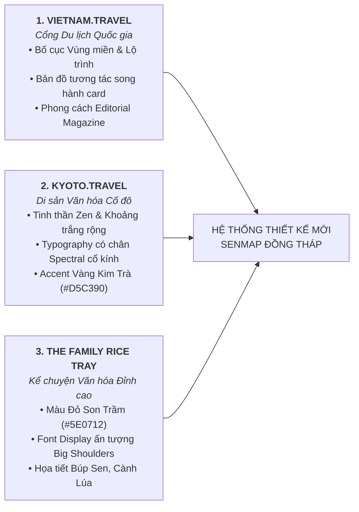

# 🏛️ BÁO CÁO PHÂN TÍCH CHUYÊN SÂU 3 WEBSITE MẪU & ĐỀ XUẤT CẢI TIẾN THIẾT KẾ SENMAP ĐỒNG THÁP

> **Dự án:** SenMap Đồng Tháp — Hệ thống Bản đồ số & Tra cứu Di tích Văn hóa - Lịch sử  
> **Chuyên trách:** Kiến trúc sư GIS & Kiểm định Tương tác (Architect_QA — `w2:p8`)  
> **Phương pháp phân tích:** Trích xuất tự động qua Headless Chrome CDP, phân tích Computed CSS tokens, DOM layout hierarchy và đối sánh thực tế với giao diện SenMap.

---

## 1. TỔNG QUAN 3 HÌNH MẪU THIẾT KẾ ĐƯỢC LỰA CHỌN



| Tiêu chí | 🇻🇳 **vietnam.travel** | 🇯🇵 **kyoto.travel/en/** | 🍚 **the-family-rice-tray** |
| :--- | :--- | :--- | :--- |
| **Bản chất sản phẩm** | Cổng Thông tin Du lịch Chính thức của Cục Du lịch Quốc gia Việt Nam | Cổng Hướng dẫn Di sản & Du lịch Cố đô Kyoto (Nhật Bản) | Tác phẩm Web Storytelling văn hóa ẩm thực Việt Nam (Awwwards) |
| **Cảm xúc mang lại** | Rực rỡ, năng động, tin cậy, chuẩn mực quốc gia | Tĩnh tại, tao nhã, đậm chất di sản, thiền định (Zen) | Nồng ấm, hoài niệm, đậm hồn cốt dân tộc, thị giác ấn tượng |
| **Nền (Background)** | Trắng ấm (`#FFFFFF`, `#FAF7F2`, `#F4ECE7`) | Trắng thanh khiết (`#FFFFFF`, `#F2F2F2`, `#EEEEEE`) | Đỏ son rượu vang (`#5E0712`, `#3F040C`, `#24040C`) |
| **Màu chữ chính** | Đen than chì (`#1E1B18`, `#252525`) | Đen tuyền & Xám than (`#000000`, `#374151`) | Kem gạo nếp (`#F7EFE0`, `#F0BE6B`, `#E3A94A`) |
| **Typography Tiêu đề** | `Noto Serif Display` (Serif uy nghi, bề thế) | `Spectral` (Serif cổ điển, thanh thoát) | `Big Shoulders Display` (Display condensed mạnh mẽ) |
| **Typography Nội dung** | `VNF Gotham Book` / `Noto Sans` (Hình học sạch) | `ui-sans-serif` / `Open Sans` (Dễ đọc quốc tế) | `Be Vietnam Pro` (Chuẩn mực ngữ âm tiếng Việt) |
| **Xử lý Bản đồ** | Bản đồ SVG Vùng miền tương tác chia cột với Cards | Lưới quận huyện & chỉ dẫn phương tiện giao thông | Khối tròn mâm cơm đồng trục tương tác |
| **Tỷ lệ Ảnh & Card** | Tỷ lệ 16:9 và 4:3, bo góc nhẹ (6-8px), không đổ bóng gắt | Tỷ lệ 3:2 và 1:1, góc vuông hoặc bo tối giản, phẳng | Ảnh cắt viền Alpha (png) kết hợp ảnh tròn mâm cơm |

---

## 2. PHÂN TÍCH CHI TIẾT TỪNG WEBSITE MẪU

### 2.1. Website 1: `https://vietnam.travel/` — Cổng Du lịch Quốc gia
#### A. Bảng màu & Bề mặt (Palette & Surfaces)
- **Nền chính:** Dùng màu trắng pha kem ngà nhạt (`#FAF7F2` và `#F4ECE7`). Đây là gam màu "giấy in ấn phẩm cao cấp", giúp mắt du khách dễ chịu hơn so với nền trắng chói `#FFFFFF`.
- **Màu nhấn (Accents):** Màu Đỏ huyết dụ hoàng thành (`rgb(139, 29, 29)` / `#8B1D1D`) kết hợp Xanh biển Đông (`#0F172A`).
- **Màu chữ:** `#1E1B18` cho tiêu đề (ấm áp hơn đen thuần `#000000`) và `#373737` cho văn bản mô tả.

#### B. Nghệ thuật Typography
- **Tiêu đề Lớn (H1, H2):** Dùng phông Serif hoa mỹ `Noto Serif Display` (34px, 800 weight), tạo cảm giác trang trọng, uy tín và giàu tính lịch sử.
- **Tiêu đề Nhỏ & Kicker:** Chữ in hoa có chân, kích thước nhỏ (12px), tăng `letter-spacing: 1.2px` tạo phong cách bìa tạp chí Vogue / Conde Nast Traveler.
- **Thân bài (Body):** Dùng phông sans-serif hình học `VNF Gotham` sạch sẽ, độ giãn dòng `line-height: 20px` trên `font-size: 14px`.

#### C. Bố cục Phân đoạn & Bản đồ
- **Bố cục "Explore Vietnam by Region":** Cực kỳ xuất sắc! Chia màn hình làm 2 cột:
  - Cột 1 (Bản đồ tương tác): Sơ đồ Việt Nam chia 3 miền, khi rê chuột hoặc click vào miền nào thì bản đồ highlight màu đỏ son.
  - Cột 2: Danh sách các điểm đến tiêu biểu của vùng đó (Hà Nội, Vịnh Hạ Long, Hội An...).
- **Thẻ nội dung (Cards):** Bo góc rất khẽ (`border-radius: 6px` - `8px`), không lạm dụng shadow nổi khối, thẻ phẳng, viền mờ tối giản. Hình ảnh chụp thiên nhiên góc rộng sắc nét.

---

### 2.2. Website 2: `https://kyoto.travel/en/` — Đỉnh cao Di sản Cố đô
#### A. Triết lý Khoảng trắng & Nhịp điệu Zen (Wabi-Sabi)
- Trang web dành đến hơn **45% diện tích cho khoảng trắng (Negative Space)**. Không có bất kỳ thành phần nào bị dồn ép, tạo cho người xem cảm giác bình an, thong thả như đang tản bộ qua một ngôi chùa cổ ở Arashiyama.
- Header trong suốt khi ở đỉnh trang, khi cuộn chuyển sang nền trắng mờ cố định (`h-91px`).

#### B. Bảng màu Nhã nhặn & Quý phái
- **Màu chủ đạo:** Nền trắng ngà và đen tuyền tối giản.
- **Màu điểm xuyết (Accent):** Màu Vàng Kim Trà Hoàng Gia Nhật Bản (`rgb(213, 195, 144)` / `#D5C390`) và Vàng Trúc Nhạt (`#F4EACE`).
- Nút CTA dạng viên thuốc bo tròn tuyệt đối (`border-radius: 9999px`), đệm padding cực thoáng (`0px 44px 0px 36px`), tạo sự mềm mại tuyệt đối.

#### C. Typography `Spectral Serif`
- Kyoto Travel sử dụng phông chữ `Spectral` (Google Fonts) cho toàn bộ H1, H2, H3:
  - H2 chính: `"KYOTO - Living Tradition"` cỡ chữ 56px, nét mảnh mà sắc sảo.
  - Chữ hiển thị mượt mà trên cả nền trắng và nền ảnh đen trắng.

---

### 2.3. Website 3: `https://the-family-rice-tray.vercel.app/` — Nghệ thuật Kể chuyện Văn hóa
#### A. Bảng màu Đỏ Son Trầm & Hoàng Kim (Imperial Crimson & Ochre Gold)
- **Nền:** Đỏ son trầm cung đình (`#5E0712`), Đỏ bã trầu đậm (`#3F040C`).
- **Màu chữ & Viền:** Màu Vàng hoa ngô / Lúa chín (`#F0BE6B`, `#E3A94A`) và Kem hạt sen nếp (`#F7EFE0`).
- Sự tương phản giữa Đỏ Thẫm và Vàng Hoàng Kim tạo nên không khí lễ hội, linh thiêng, ấm cúng và cực kỳ bắt mắt.

#### B. Typography Display Cá tính
- Sử dụng phông chữ `Big Shoulders Display` (cỡ 72px H1, 46px H2) viết in hoa, tỉ lệ hẹp (condensed), tạo nhịp đập thị giác cực kỳ mạnh mẽ.
- Kết hợp với phông thân bài `Be Vietnam Pro` (18.5px, line-height 32px thoáng đãng), đọc tiếng Việt mượt mà không lỗi dấu.

#### C. Yếu tố Minh họa Truyền thống
- Trang web lồng ghép các hình vẽ minh họa vector/PNG trong suốt: Cành lúa trĩu hạt, bông sen hồng, họa tiết rồng thời Lý. Các hình ảnh không bị bó hẹp trong khung vuông mà vươn ra ngoài mép, tạo độ sâu không gian 3D.

---

## 3. ĐỐI CHIẾU VỚI GIAO DIỆN HIỆN TẠI CỦA SENMAP ĐỒNG THÁP

| Yếu tố Thiết kế | SenMap Hiện tại | Đánh giá & Điểm yếu | Cần Thay đổi theo 3 Mẫu |
| :--- | :--- | :--- | :--- |
| **Tông màu Tổng thể (Theme)** | Nền tối đen than chì `bg-slate-950` phủ toàn bộ trang. | Hơi nặng nề, giống một "Dashboard giám sát kỹ thuật" hoặc "Ứng dụng Gaming" hơn là Cổng Văn hóa - Du lịch Xứ Sen Hồng. | **Chuyển sang phong cách Hybrid Editorial:** Nền màu Kem Giấy Điệp / Hạt Sen sáng ấm (`#FAF7F2` như `vietnam.travel`), điểm xuyết các phân đoạn Đỏ Son Trầm / Hồng Sen Sang Trọng (`#5E0712` hoặc Hồng Sen Trầm như `the-family-rice-tray`). |
| **Typography Tiêu đề** | Toàn bộ dùng Sans-serif (`Be Vietnam Pro` bold/black). | Thiếu chiều sâu văn hiến, thiếu chất thơ lịch sử của vùng đất Óc Eo - Phù Nam cổ và truyền thống trăm năm Cao Lãnh - Sa Đéc. | **Tích hợp Typography Kép:** Tiêu đề lớn dùng **Serif Cổ Điển** (`Noto Serif` / `Lora` / `Spectral` như `vietnam.travel` & `kyoto.travel`); Tiêu đề số liệu/kicker dùng **Condensed Display** (`Big Shoulders Display`); Thân bài giữ vững **`Be Vietnam Pro`**. |
| **Khoảng trắng (Whitespace)** | Khoảng cách các section dày đặc, padding hẹp (py-12). | Thiếu "nhịp thở" (breathing room), người xem bị ngợp thông tin. | **Tăng cường Whitespace kiểu Kyoto:** Nâng padding lên `py-24 md:py-32`, lùi lề rộng rãi, phân cách bằng hoa văn sen nét mảnh thanh nhã thay vì viền xám thô. |
| **Bố cục Thẻ Card (Cards)** | Bo góc lớn (`rounded-3xl`), nhiều viền phát sáng gradient glow, bóng đổ nặng (`shadow-2xl`). | Quá nhiều chi tiết thị giác cạnh tranh nhau, phân tán sự chú ý vào ảnh chụp thực tế di tích. | **Card Tạp chí Tinh gọn (Editorial Minimalism):** Bo góc nhỏ hơn (`rounded-2xl`), nền màu ngà sáng hoặc kính mờ tinh tế, viền mảnh 1px, tỷ lệ ảnh 16:9 hoặc 4:3 sắc nét với badge danh mục nhỏ gọn. |
| **Bản đồ GIS trên Trang chủ** | Khối bản đồ Leaflet hình chữ nhật nằm độc lập ở Tầng 4. | Chưa có sự kết nối trực quan giữa câu chuyện di tích và bản đồ địa lý. | **Học tập Bản đồ Vùng miền của `vietnam.travel`:** Thiết kế bố cục **Split-Screen (Bản đồ tương tác bên trái + Thẻ Tuyến/Di tích cuộn bên phải)** hoặc bản đồ tương tác dạng Bento Grid. |

---

## 4. BẢN ĐỀ XUẤT CẢI TIẾN THIẾT KẾ SENMAP ĐẤT SEN HỒNG (ACTIONABLE BLUEPRINT)

### 4.1. Hệ Màu Mới: "Sen Hồng - Đất Mẹ - Tràm Xanh" (Heritage Warm Palette)
```
[Nền Giấy Điệp / Hạt Sen]   #FAF7F2   (Light Warm Surface)
[Nền Kem Ngà Trầm]           #F4ECE7   (Card Sub-surface)
[Hồng Sen Đồng Tháp]         #E11D48   (Rose-600 - Primary Brand)
[Đỏ Son Cung Đình]           #5E0712   (Deep Crimson Accent - Thừa hưởng từ the-family-rice-tray)
[Vàng Lúa Chín / Sen Vàng]   #E3A94A   (Heritage Ochre Gold - Thừa hưởng từ Kyoto & Mâm Cơm)
[Xanh Tràm Gáo Giồng]        #059669   (Emerald-600 - Secondary GIS)
[Đen Than Trầm]              #1E1B18   (Text Primary - Thay thế đen thô #000000)
```

### 4.2. Cấu trúc 6 Tầng Trang Chủ Cải Tiến (Reimagined Layout)
1. **Hero Portal (Hơi thở Kyoto + Mâm Cơm):**
   - Video/Ảnh toàn cảnh VQG Tràm Chim hoặc Sen Tháp Mười bao phủ nhẹ nhàng.
   - Headline Serif cỡ lớn: *"ĐẤT SEN HỒNG — Nơi Hội Tụ Trăm Năm Di Sản"*.
   - Thanh tìm kiếm nổi tích hợp thời tiết Đồng Tháp & gợi ý di tích nhanh theo mùa.
2. **Khu vực Tuyến Văn hóa Bản đồ Song hành (Học tập `vietnam.travel` Region Map):**
   - Bên trái: Bản đồ WebGIS Đồng Tháp thu nhỏ gọn gàng, tự động sáng đèn các điểm dừng khi chọn tuyến.
   - Bên phải: 4 Tuyến chủ đề trình bày dạng thẻ bìa tạp chí cao cấp.
3. **Vitrin Kiệt tác Di sản (Editorial Magazine Masonry):**
   - 4 Quần thể Di sản Trọng điểm (2 Di tích Quốc gia Đặc biệt: Nguyễn Sinh Sắc, Gò Tháp; cùng 2 Di tích Quốc gia & Khu Ramsar: Xẻo Quýt, Tràm Chim) trình bày với tỷ lệ ảnh lớn, trích dẫn âm hưởng lịch sử, nút Audio Tour mini nghe thử ngay tại chỗ.
4. **Hộ chiếu Di sản & Con Dấu Kỹ thuật số (Interactive Heritage Passport):**
   - Tích hợp trải nghiệm đóng dấu mộc đỏ tương tác sống động như cách *The Family Rice Tray* cho người dùng "dọn mâm cơm".
5. **Bản đồ Số WebGIS Toàn năng (Full WebGIS Explorer):**
   - Khung bản đồ rộng thoáng, công cụ tìm đường TSP 2-Opt và các bộ lọc thông minh.
6. **Lịch 4 Mùa & 12 Hương vị Đồng Tháp (Kyoto Travel Seasonal Guide):**
   - Giao diện lịch mùa sen nở, mùa nước nổi, mùa hoa Sa Đéc kết hợp ẩm thực truyền thống.

---

### 5. KẾT LUẬN & KIẾN NGHỊ TIẾP THEO
Việc dung hợp tinh hoa từ **vietnam.travel** (chuẩn mực Cổng Du lịch Quốc gia), **kyoto.travel** (chiều sâu di sản và khoảng trắng Zen) cùng **the-family-rice-tray** (kỹ thuật kể chuyện thị giác bản sắc Việt) sẽ nâng tầm SenMap Đồng Tháp từ một *dự án đồ án GIS thông thường* thành một **Cổng Không gian Số Di sản Văn hóa Đẳng cấp Quốc tế**, đáp ứng xuất sắc cả yêu cầu học thuật KLTN lẫn trải nghiệm thực tế của người dùng.
